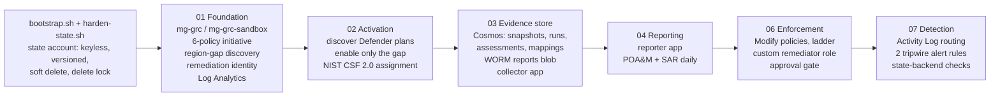

# Tallyfin GRC Pipeline (CGE-AZ capstone)

An automated **governance, risk and compliance (GRC) engineering pipeline on Microsoft Azure**. It defines a governed cloud environment as code, collects compliance evidence on a schedule, writes audit reports from that stored evidence alone, and fixes misconfigurations through one auditable identity, only after a human approves the fix.

**Tallyfin** is a fictional fintech used as the business case: a Plaid-style API that lets consumer apps connect to people's bank accounts. No real company data is used anywhere in this repository.

Built on the [CGE-AZ starter](https://github.com/GRCEngClub/cgeaz) from the GRC Engineering Club and substantially extended. [What changed from the starter](#part-7--what-this-capstone-adds-to-the-starter) is summarized below, and every decision is argued in [docs/DECISIONS.md](docs/DECISIONS.md).

---

## How to read this README

This README is written for three readers. Jump to the part that fits you.

| You are... | Read | Time |
|---|---|---|
| **A business stakeholder** (leadership, risk, legal, a customer's security reviewer) | [Part 1: The plain-language overview](#part-1--the-plain-language-overview) | 10 min |
| **Learning GRC engineering** | [Part 2: Concepts primer](#part-2--grc-engineering-concepts-a-primer), then Part 3, then the [learning path](#part-9--a-learning-path-through-this-repo) | 1-2 h |
| **An engineer or assessor** | [Part 3: Architecture](#part-3--technical-architecture), [Part 4: Deploy](#part-4--deploy-from-an-empty-subscription), [Part 6: Evidence](#part-6--where-an-assessor-should-look) | 30 min |

Contents

1. [The plain-language overview](#part-1--the-plain-language-overview)
2. [GRC engineering concepts: a primer](#part-2--grc-engineering-concepts-a-primer)
3. [Technical architecture](#part-3--technical-architecture)
4. [Deploy from an empty subscription](#part-4--deploy-from-an-empty-subscription)
5. [Verify it yourself](#part-5--verify-it-yourself)
6. [Where an assessor should look](#part-6--where-an-assessor-should-look)
7. [What this capstone adds to the starter](#part-7--what-this-capstone-adds-to-the-starter)
8. [Honest limits and accepted risks](#part-8--honest-limits-and-accepted-risks)
9. [A learning path through this repo](#part-9--a-learning-path-through-this-repo)
10. [Repository layout](#repository-layout)

---

## Part 1 — The plain-language overview

### The business problem

Tallyfin's product connects consumer apps to people's bank accounts. That puts it under three sets of obligations at once:

- **The GLBA Safeguards Rule (16 CFR 314.4).** A US federal rule for companies holding nonpublic personal financial information. It requires access controls, encryption, an inventory of where data lives, logging and monitoring, change management, and continuous monitoring of whether all of that actually works.
- **PCI DSS 4.0.1.** The card industry's security standard. Tallyfin is in scope as a service provider.
- **SOC 2.** Tallyfin's customers (the consumer apps) will ask for a SOC 2 report before trusting it with their users' bank connections.

The traditional way to satisfy these is a yearly scramble: people take screenshots of settings, fill in spreadsheets, and hand them to an auditor. That approach has three problems:

1. **It is a snapshot.** A setting that was correct on audit day can be wrong the next morning, and nobody notices for a year.
2. **It is unverifiable.** A screenshot can't prove when it was taken, that it wasn't edited, or that it shows the whole picture.
3. **It doesn't fix anything.** It only records problems.

### What this pipeline does instead

Think of it as five jobs, each done by software instead of by a person with a spreadsheet:

| Job | In plain words | Analogy |
|---|---|---|
| **1. Set the rules** | Security rules (for example "no storage may be publicly readable", "data must stay in US regions") are written as code and applied to every part of the cloud environment automatically, including parts added in the future. | Building codes that apply to every new building, not just the ones that exist today. |
| **2. Watch continuously** | Every 6 hours, a collector asks Azure "which resources follow the rules and which don't?" and records the answer. | A security guard doing rounds four times a day and writing down what they see. |
| **3. Keep tamper-evident records** | Every observation is stored with when it was made and by which run. Each run is sealed with a fingerprint (a cryptographic hash), so any later edit is detectable. Reports go into storage that physically cannot be altered or deleted for 90 days. | An evidence locker with a sealed log book. |
| **4. Report from the records** | Every day, two reports are written: a **POA&M** (the to-do list of open problems, with due dates) and a **SAR** (the assessment report: what passes, what fails, what changed). Reports read only the stored records, so every number can be traced back and re-checked. | An auditor's report that cites its evidence, page by page. |
| **5. Fix, with permission** | When a known problem needs fixing, the fix is prepared automatically but only runs after a person approves it in a reviewed change. One named robot identity performs every fix, so every automated change has a single, traceable author. | A maintenance crew that has a work order signed by a manager before it touches anything. |

And around those five jobs, the pipeline **protects itself**:

- Any proposed change to the environment is checked against the rules **before** it can be merged (a "compliance gate").
- Every night, the pipeline checks whether the real environment still matches the code ("drift detection").
- Every 15 minutes, it checks the audit log for changes made by anyone who isn't expected to be making changes ("tripwires").

### What leadership actually gets

| Output | What it answers | Who uses it |
|---|---|---|
| **POA&M** (Plan of Action and Milestones), daily, JSON + Excel | "What is broken right now, how bad is it, since when, and when must it be fixed?" Due dates come from severity: High = 30 days, Medium = 90, Low = 180, counted from the day the problem was **first** seen. | Engineering managers, risk owners |
| **SAR** (Security Assessment Report) + scorecard, daily | "How do we score against NIST CSF 2.0, NIST 800-53, PCI DSS, SOC 2 and GLBA? What got fixed since last time?" | Leadership, auditors, customer security reviews |
| **Alerts** | "Someone changed the environment outside the approved process." | Security / GRC team |
| **Drift issues** on GitHub | "The environment no longer matches what we approved." | Platform engineers |

One collection serves all five frameworks. The pipeline records each fact **once** and maps it to every framework through a single translation table ([frameworks/mappings.json](frameworks/mappings.json)). This is called **collect once, map many**, and it's the main reason GRC engineering is cheaper than one audit project per framework.

### What you can rely on, and what you can't

Good GRC work is explicit about the limits of its claims. Here are this pipeline's.

**You can rely on:**
- Rules are enforced the same way everywhere they apply, because they're code inherited from the top of the environment.
- A report's numbers can be re-derived from stored records at any later time ([scripts/reproduce_report.py](scripts/reproduce_report.py)).
- A report will **refuse to publish** if its evidence is stale (older than 13 hours), incomplete (a collection run that partly failed), or altered after it was sealed.
- No automated fix runs without a human approval recorded in git history.
- No stored passwords or keys are needed for the pipeline's own data, with one documented, time-boxed exception (see [Part 8](#part-8--honest-limits-and-accepted-risks)).

**You should not assume:**
- That "no finding" means "fixed." The SAR only counts something as fixed when it sees an explicit fail-then-pass. A finding that just disappears is reported as "no longer observed."
- That this is production-grade. It's a capstone in a single sandbox subscription. The trade-offs, and what production would do instead, are written down in [docs/DECISIONS.md](docs/DECISIONS.md).

---

## Part 2 — GRC engineering concepts: a primer

If you're learning, read this part slowly. Every concept here shows up in the code, and each entry points to where.

### Controls: preventive, detective, corrective

A **control** is anything that reduces risk. GRC sorts controls by *when* they act:

| Type | Acts | Example in this repo | File |
|---|---|---|---|
| **Preventive** | Before the bad thing happens | Azure Policy `Deny` blocks creating a publicly readable storage account | [stages/01-foundation/policies.tf](stages/01-foundation/policies.tf) |
| **Detective** | Notices after it happens | Azure Policy `Audit` marks non-compliant resources; the collector records them | [stages/01-foundation/policies.tf](stages/01-foundation/policies.tf), [functions/collect_assessments/](functions/collect_assessments/) |
| **Corrective** | Fixes it | Azure Policy `Modify` flips a bad setting back, through a remediation task | [stages/06-enforcement/main.tf](stages/06-enforcement/main.tf) |
| **Governance** | Decides who may change the rules | CODEOWNERS review, the approval file, the escalation ladder | [.github/CODEOWNERS](.github/CODEOWNERS), [stages/06-enforcement/approvals.auto.tfvars](stages/06-enforcement/approvals.auto.tfvars) |

[docs/CONTROLS.md](docs/CONTROLS.md) labels every component with its type (P / D / C / G).

### Azure Policy effects

Azure Policy is Azure's built-in rules engine. Each rule ("policy definition") has an **effect**, which decides what happens when a resource breaks the rule:

- **Audit**: allow it, but mark it non-compliant. The safe way to introduce a new rule, because you first *measure* how much it would break.
- **Deny**: refuse the create or update request. Strong, but it can break deployments, so it must be **earned**.
- **Modify**: rewrite a property on the resource (for example, set `minimumTlsVersion` to `TLS1_2`). Needs an identity with permission to make the change.
- **DeployIfNotExists (DINE)**: deploy something that's missing (for example, a diagnostic setting that sends logs to the workspace). Also needs an identity.

**Lesson:** Modify and DINE need an identity, and if you forget it, the assignment applies cleanly and then silently never fixes anything. This repo's gate rule TF-POL-001 makes that mistake unmergeable ([policy/policy_identity.rego](policy/policy_identity.rego)).

### Management groups and inheritance

Azure organizes subscriptions under **management groups** (`mg-grc` → `mg-grc-sandbox` → the subscription). A policy assigned at a management group applies to every subscription beneath it, **including ones added later**. That's why this repo assigns its six-policy **initiative** (a bundle of policies) once at `mg-grc-sandbox`, rather than per resource.

### Infrastructure as code, state, and stages

**Terraform** describes the environment in files (`*.tf`). `terraform plan` shows what would change, and `terraform apply` makes it so. Terraform remembers what it manages in a **state file**.

- Whoever can write the state can make Terraform believe something false. So the state is treated as a controlled record: no shared keys, versioning, soft delete, and a delete lock ([labs/03-foundation/harden-state.sh](labs/03-foundation/harden-state.sh)). Stage 07 re-checks those settings on every nightly plan ([stages/07-detection/state_backend.tf](stages/07-detection/state_backend.tf)).
- The environment is split into **stages**, each a separate Terraform "root module" with its **own state file**. A mistake in one stage can't rewrite another's. Stages share information only through outputs (`terraform_remote_state`). That separation is a **blast-radius boundary**.

### Discovery first, then activation

Never switch on a control blindly. **First read** what exists, **measure the gap**, then act only on the gap:

- Stage 02 reads which Microsoft Defender plans are already on and enables only the missing ones ([stages/02-activation/main.tf](stages/02-activation/main.tf)).
- Stage 01 inventories every resource's region. The data-residency policy stays at **Audit** while any resource sits outside the approved regions, and becomes **Deny** automatically once that count is zero ([stages/01-foundation/discovery.tf](stages/01-foundation/discovery.tf)). Denying while stragglers exist would block their next update, and the guardrail would cause the outage it exists to prevent.

### Evidence, lineage and integrity

**Evidence** is a record that a control was tested and what the result was. To be worth anything to an auditor, it needs:

- **Lineage:** which run produced it, when it was observed (`collectedAt`), and when the platform last evaluated it (`sourceEvaluatedAt`). Those two times are not the same thing.
- **History:** a new record per run, not an overwrite, so you can say *when* a problem first appeared.
- **Integrity:** a way to detect later changes. Each run's manifest stores two **SHA-256 digests**: one over the set of document IDs (catches added or removed records) and one over every document's content (catches a record edited in place).
- **Immutability:** **WORM** (write once, read many) storage. The reports container has a time-based immutability policy. For 90 days, nobody can delete or overwrite a report blob, including administrators. It's a platform guarantee, not a permission setting.

### POA&M and SAR

- **POA&M (Plan of Action and Milestones):** the standard US-government-style list of open weaknesses, each with a severity, an owner hint, a first-seen date and a scheduled completion date.
- **SAR (Security Assessment Report):** the assessor's view: which requirements pass or fail, per framework, and what changed since the previous assessment.

### The crosswalk: collect once, map many

A **crosswalk** maps one technical check to the matching requirements in several frameworks. For example, "storage public access disallowed" maps to NIST CSF 2.0 PR.DS-01, NIST 800-53 AC-3, PCI DSS 1.4.1, SOC 2 CC6.1 and GLBA 314.4(c)(1). This repo keeps the crosswalk as **data** ([frameworks/mappings.json](frameworks/mappings.json): 13 controls × 5 frameworks), versioned by content hash. Each run records which crosswalk version it used, and a test fails CI if a policy in Terraform is missing from the crosswalk.

### Least privilege and segregation of duties (SoD)

- **Least privilege:** each identity gets exactly the permissions its job needs. The remediation identity can update storage account properties but can't read keys, delete accounts, or read data (custom role `tf-storage-baseline-remediator`).
- **Segregation of duties:** no single identity can do two jobs that should check each other. The **collector** writes evidence but can't write reports. The **reporter** reads evidence and writes reports but can't change evidence, and has **no Azure Resource Manager role at all**, so it physically can't query live systems. This is enforced by role **scope**, not by code review.
- **Managed identities:** Azure-issued identities for workloads. There's no password to store or leak.

### OIDC federation for CI

GitHub Actions needs to read Azure to run `terraform plan`. Instead of storing a secret, the workflow presents a short-lived **OIDC token** that Azure trusts only if its "subject" matches exactly (for example `repo:ThePrivacyPrince/CGE-Azure-Capstone:pull_request`). No credential is stored anywhere. The CI identity is **read-only**: a workflow file can be edited by the very pull request it gates, so the identity's permissions, not the workflow's intent, are the real security boundary.

### Policy as code (the gate)

**OPA / Rego** is a language for writing rules about structured data. **conftest** runs those rules against a Terraform plan exported as JSON. This repo's gate has **12 rules** (11 deny + 1 visibility warning) in [policy/](policy/), with **23 unit tests** proving that each rule fires on bad input and stays quiet on good input. Exceptions are per resource, ticketed, reviewed, and **expire** ([policy/exceptions.rego](policy/exceptions.rego)), so they decay instead of piling up.

### Drift: the two questions

**Drift** is when reality stops matching the approved code. There are two different questions, and each needs its own detector:

1. **Does reality match the code?** A nightly `terraform plan -detailed-exitcode` (exit 2 = differences). If it finds drift, it opens a GitHub issue ([.github/workflows/drift.yml](.github/workflows/drift.yml)). Limitation: a plan only sees resources in its own state.
2. **Who is touching reality?** Activity Log **tripwires**: alert rules that fire when an unexpected principal writes anything in the subscription, managed by Terraform or not ([stages/07-detection/main.tf](stages/07-detection/main.tf)).

### The escalation ladder and blast radius

Enforcement is turned up in reviewed steps: `audit` → `dry-run` → `enforce`. Each step is a pull request in a CODEOWNERS-protected path. Before any step, you read the **blast radius**: what it changes, what could break, how you'd know, and how to roll back ([docs/BLAST-RADIUS.md](docs/BLAST-RADIUS.md)). The rule of thumb: **automation acts, humans authorize.**

---

## Part 3 — Technical architecture

### The stage flow



Deploy order is the numeric order. Stage 05 (an optional AI-narrative stage in the course) isn't built here. Each stage has its own state file, `<stage>.tfstate`, in one Entra-only, versioned state account.

### The closed loop, end to end

```mermaid
sequenceDiagram
  autonumber
  participant AP as Azure Policy
  participant DF as Defender for Cloud
  participant C as Collector (every 6 h)
  participant DB as Cosmos DB (evidence)
  participant R as Reporter (daily)
  participant W as WORM blob (reports)
  participant H as Human reviewer (PR)
  participant RI as Remediation identity
  participant AL as Activity Log + tripwires
  C->>DB: run manifest "started"
  C->>AP: query policy compliance states
  C->>DF: list security assessments
  C->>DB: one snapshot per finding (id = sha256(runId|findingKey))
  C->>DB: manifest "completed" + id digest + content digest
  R->>DB: newest COMPLETED, fresh run; verify both digests
  R->>W: poam.json/xlsx, sar.md, scorecard.json, then manifest.json LAST
  H->>H: reads the POA&M, opens a PR approving a fix + ticket
  H->>AP: merge + apply creates a remediation task
  AP->>RI: task runs AS the user-assigned identity
  RI->>AL: storage property write (caller = its principal ID)
  AL->>AL: tripwire checks the remediator stayed in its lane
  C->>DB: next run records the control passing
  R->>W: next SAR lists it under "fixed" (explicit fail -> pass)
```

### Stage by stage

Each stage below gives what it builds, the files to read, and the GRC lesson it carries.

#### 0. Bootstrap: the state account
- **Builds:** the storage account that holds every stage's Terraform state, with shared keys off, versioning, 30-day soft delete, change feed, and a `CanNotDelete` lock.
- **Read:** [labs/03-foundation/bootstrap.sh](labs/03-foundation/bootstrap.sh), [labs/03-foundation/harden-state.sh](labs/03-foundation/harden-state.sh)
- **Lesson:** the state can't manage itself, so it's created by script and then **re-verified** by Terraform postconditions in stage 07 on every plan. If someone re-enables shared keys, the nightly drift run goes red with the reason.

#### 01. Foundation: hierarchy, rules, the fixer's identity
- **Builds:**
  - Management groups `mg-grc` → `mg-grc-sandbox`, with the subscription placed under them.
  - Resource groups, and the Log Analytics workspace `law-grc-sandbox`.
  - The user-assigned **remediation identity** `id-grc-remediation-dev`, holding only Monitoring Contributor (for diagnostic settings).
  - A six-policy **initiative** assigned once at `mg-grc-sandbox`:

| # | Policy | Effect | Why that effect | Source |
|---|---|---|---|---|
| 1 | `cge-require-env-tag-rg`: resource groups carry an `env` tag | Audit | Hygiene, not a hard block | Starter |
| 2 | `cge-deny-public-blob`: no public blob access | **Deny** | Clear-cut and framework-mandated: earned | Starter |
| 3 | `cge-dine-storage-diagnostics`: storage sends diagnostics to the workspace | DeployIfNotExists | Logging that enforces its own coverage | Starter |
| 4 | **`tf-storage-min-tls12`**: storage requires TLS 1.2 | Audit | New control: measure first | **Tallyfin** (GLBA 314.4(c)(3), PCI 4.2.1) |
| 5 | **`tf-cosmos-no-local-auth`**: Cosmos DB rejects key auth | Audit | Data-service Deny gets its own reviewed change | **Tallyfin** (attributable access) |
| 6 | **`tf-allowed-locations`**: US regions only | Audit until the measured gap is 0, then Deny | Discovery-first | **Tallyfin** (data residency) |

- **Read:** [main.tf](stages/01-foundation/main.tf), [policies.tf](stages/01-foundation/policies.tf), [identity.tf](stages/01-foundation/identity.tf), [discovery.tf](stages/01-foundation/discovery.tf)
- **Lesson:** each effect is a *decision* with a reason, recorded next to the code. The allowed regions (`eastus`, `eastus2`, `centralus`) are exactly the regions the stages already use, and why each is needed is in ADR-003.

#### 02. Activation: Defender plans, discovery first
- **Builds:** reads each baseline Microsoft Defender plan's current tier (with `azapi`, because `azurerm` has no data source for it), enables only the missing ones, and assigns the built-in **NIST CSF 2.0** regulatory compliance initiative.
- **Read:** [stages/02-activation/main.tf](stages/02-activation/main.tf)
- **Lesson:** the "gap map" is an *output*, deliberately not a resource key. Keying resources on live values you're about to change makes Terraform undo its own work on the next run (the read-your-own-writes trap).

#### 03. Evidence store: the records we own
- **Builds:**
  - **Cosmos DB** (serverless, `eastus2`), with key auth disabled and key-based metadata writes blocked. Containers:

| Container | Partition key | One document per | Purpose |
|---|---|---|---|
| `snapshots` | `/runId` | finding, per run | History. `id = sha256(runId \| findingKey)` is unique per run and deterministic within it, so retries are idempotent. `findingKey = sha256(source \| nativeId \| resourceId)` is stable across runs, so "first seen" can be computed. |
| `runs` | `/runId` | collection run | Manifest: `started` → `completed` / `partial` / `failed`, trigger (`timer` or `manual`), counts, per-source errors, crosswalk version, `documentSetSha256` (IDs) and `contentSetSha256` (content). |
| `assessments` | `/subscriptionId` | Defender finding (latest) | The starter's latest-state view, kept so older queries still work. |
| `mappings` | `/frameworkId` | crosswalk version | `frameworks/mappings.json`, stored with its content hash. |
| `frameworks` | `/frameworkId` | framework element | NIST CSF 2.0 catalog (seeded once). |

  - **Evidence storage account:**
    - Shared keys off, OAuth by default, TLS 1.2, HTTPS only.
    - Versioning, change feed, and 30-day soft delete.
    - The `reports` container with a **90-day WORM immutability policy**.
  - `CanNotDelete` **locks** on Cosmos and the evidence storage account.
  - **Data-plane diagnostic logs** for both (who read or wrote evidence is itself evidence; a failed WORM delete shows up in `StorageDelete`).
  - The **collector** Function App: Python, timer every 6 hours (`0 0 */6 * * *`), system-assigned managed identity. Its roles are Security Reader (Defender assessments), a custom `tf-grc-policy-state-reader` (Policy states, one POST action), and Cosmos Built-in Data Contributor.
- **Read:** [main.tf](stages/03-evidence-store/main.tf), [integrity.tf](stages/03-evidence-store/integrity.tf), [collector.tf](stages/03-evidence-store/collector.tf), [functions/collect_assessments/evidence_core.py](functions/collect_assessments/evidence_core.py)
- **Lesson:** a run with any source error is marked `partial`, and reports never use it. Missing evidence must never read as "no findings."

#### 04. Reporting: numbers that trace to stored records
- **Builds:** the **reporter** Function App with two daily timers: POA&M at 06:40 UTC and SAR + scorecard at 06:50 UTC, after the 06:00 collection. Its identity has Cosmos **Data Reader** plus a custom `tf-grc-report-writer` role on the `reports` container only (create and read blobs; no delete, no container management). It has no ARM role.
- **How a report is made** ([functions/reports/reports_core.py](functions/reports/reports_core.py)):
  1. Pick the newest run whose manifest says `completed`. Refuse if it finished more than 13 hours ago (`MAX_RUN_AGE_HOURS`).
  2. Load that run's snapshots. Recompute both digests. Refuse to publish if either differs from the sealed manifest.
  3. Load the exact crosswalk version the run recorded.
  4. Compute first-seen dates from history, then due dates from severity SLAs (High 30, Medium 90, Low 180 days).
  5. Write the artifacts into a new folder `<report>/<yyyy>/<mm>/<dd>/<timestamp>-<executionId>/`, then write `manifest.json` **last**, with every file's SHA-256 and every Cosmos query verbatim. A folder without a manifest is, by contract, an incomplete execution.
- **Lesson:** because the reporter can't call live APIs, "reports read from the store only" is enforced by identity, not by convention, and [scripts/reproduce_report.py](scripts/reproduce_report.py) can re-run every query later.

#### 06. Enforcement: corrective controls behind a human gate
- **Builds:**
  - Two **Modify** policies in a `for_each` map: `cge-fix-public-blob` (starter) and **`tf-fix-min-tls`** (Tallyfin's own). Both assignments use the single remediation identity.
  - The custom **`tf-storage-baseline-remediator`** role: storage account read/write and resource group read, with `listKeys`, `regenerateKey` and `delete` explicitly excluded.
  - The **approval gate as code**: remediation tasks are created only for control keys listed in [approvals.auto.tfvars](stages/06-enforcement/approvals.auto.tfvars), each with a change ticket. Terraform refuses an approval without a ticket.
- **The ladder** (`remediation_mode`, default `dry-run`):

| Mode | What happens |
|---|---|
| `audit` | Policies only evaluate. The remediator role is **removed**. |
| `dry-run` (default) | Modify is deployed with enforcement off. Nothing changes until a reviewer approves a key. |
| `enforce` | Modify rewrites every new create or update in flight. Existing resources still need an approved task. |

- **How approval works:**
  1. Read the POA&M.
  2. Open a PR adding `approved_remediations = ["fix-public-blob"]` and `remediation_change_ticket = "chg-0001"`. CODEOWNERS review is required.
  3. Merge and apply. This creates task `rem-fix-public-blob-chg-0001`.
  4. Open a second PR that removes the key, so the file always shows what's pending.
- **Read:** [stages/06-enforcement/main.tf](stages/06-enforcement/main.tf), [docs/BLAST-RADIUS.md](docs/BLAST-RADIUS.md)
- **Lesson:** a policy's `roleDefinitionIds` field only tells the portal what to auto-grant. It grants nothing. The identity's *actual* role is what bounds the blast radius (ADR-011).

#### 07. Detection: who is touching reality
- **Builds:**
  - Activity Log routing to the workspace (adopted from Lab 2 with a Terraform `import` block, not duplicated).
  - An email action group.
  - Two scheduled **tripwire** alert rules, evaluated every 15 minutes:
    - **Unexpected writer:** any successful write or delete by a caller who isn't in `approved_change_callers` and isn't the remediation identity.
    - **Remediator out of lane:** any operation by the remediation identity other than storage writes, deployments and diagnostic settings. This is the compensating control for the fact that `storageAccounts/write` can't be limited to one property.
  - The state-backend postconditions.
- **Read:** [stages/07-detection/main.tf](stages/07-detection/main.tf), [stages/07-detection/state_backend.tf](stages/07-detection/state_backend.tf)
- **Lesson:** Activity Log rows often arrive several minutes late. The rules look back one hour by event time but count only rows *ingested* in the last 15 minutes, so each row is evaluated exactly once: none are missed and none are double-counted.

### Identities and what each can't do

| Identity | Type | Can | Cannot |
|---|---|---|---|
| Remediation `id-grc-remediation-dev` | User-assigned MI | Monitoring Contributor (DINE diagnostics); storage property read/write (only when mode ≠ audit) | Read keys, delete storage, read data, touch other resource types |
| Collector | System-assigned MI | Read Defender + Policy states; write Cosmos | Change any resource; write reports |
| Reporter | System-assigned MI | Read Cosmos; create report blobs | **Any** ARM call; write evidence; delete reports |
| CI planner (GitHub OIDC) | Federated app | `*/read` + refresh list actions at `mg-grc`; read state | Change anything; write or lock state |
| Human operator | Entra user | Apply Terraform; approve PRs | n/a (listed as an expected caller for the tripwire) |

The full table, with diagrams, is in [docs/ARCHITECTURE.md](docs/ARCHITECTURE.md#identity-boundaries).

### The CI gate ([.github/workflows/gate.yml](.github/workflows/gate.yml))

The gate runs in two jobs, so trust is split:

| Job | Runs on | Credentials | Checks |
|---|---|---|---|
| `static checks (no credentials)` | Every PR, forks included | **None** | `terraform fmt`, `terraform validate` per stage, tflint, checkov, OPA unit tests, the gate must **block** the known-bad fixture and pass the good one, pytest, gitleaks |
| `plan + OPA gate (<stage>)` | PRs from branches in this repo only | Read-only OIDC planner | Real `terraform plan -lock=false` per stage → conftest against the plan JSON |

The gate's rules:

| Rule | Blocks |
|---|---|
| TF-IAM-001 | Owner / Contributor / User Access Administrator / RBAC Admin grants, by name **or** GUID |
| TF-IAM-002 | Custom roles with `*` actions |
| TF-POL-001 | A remediating policy assignment with no identity (fails closed when it can't prove the assignment is non-remediating, including parameterized effects that allow Modify) |
| TF-POL-002 | Remediation through a system-assigned identity instead of the named one |
| TF-STG-001..004 | Public blobs, shared keys (unless excepted), TLS < 1.2, HTTP allowed |
| TF-STG-005 | Cosmos key auth re-enabled |
| TF-STG-900 *(warn)* | A security attribute unknown until apply. The gate says it can't see it rather than passing silently. |
| TF-EVD-001 / 002 | Deleting or replacing the evidence plane; shortening WORM retention |

### Scheduled operations

| What | When (UTC) | Where |
|---|---|---|
| Collector | every 6 h at :00 | Function timer (`COLLECT_SCHEDULE`) |
| POA&M | 06:40 daily | Function timer (`POAM_SCHEDULE`) |
| SAR + scorecard | 06:50 daily | Function timer (`SAR_SCHEDULE`) |
| Guide parse canary | 07:00 daily | [guide-ci.yml](.github/workflows/guide-ci.yml) |
| Drift plan, all stages | 08:00 daily | [drift.yml](.github/workflows/drift.yml): opens an issue on drift, fails the job if the plan itself errors |
| Tripwires | every 15 min | Stage 07 alert rules |

Azure Policy evaluation, Defender refresh, Activity Log ingestion and these schedules aren't synchronized. A fix can show as Policy-compliant before Defender re-assesses it. That's why "fixed" requires an explicit fail → pass in stored evidence.

---

## Part 4 — Deploy from an empty subscription

Full detail, expected plan outputs and failure modes are in [docs/RUNBOOK.md](docs/RUNBOOK.md). Windows users: [docs/SETUP-WINDOWS.md](docs/SETUP-WINDOWS.md).

**Prerequisites**
- Azure CLI ≥ 2.60 (`az login`), Terraform ≥ 1.9, Python 3.11.
- An Azure subscription where you are **Owner** and can create management groups (tenant-root permission for the first one).
- The one-time setup in [docs/SETUP.md](docs/SETUP.md): resource providers registered, quota probed (`labs/00-setup/probe-quota.sh`), and a budget created (`labs/01-sandbox/create-budget.sh`).

**Order**

```bash
export ARM_SUBSCRIPTION_ID=$(az account show --query id -o tsv)
export TF_VAR_subscription_id=$ARM_SUBSCRIPTION_ID
export TF_VAR_owner_email="<you@example.com>"          # PII: environment only, never committed
export TF_VAR_alert_email="<alerts@example.com>"
export TF_VAR_approved_change_callers='["<your UPN>"]'

./labs/03-foundation/bootstrap.sh                      # 0. state account (versioned, keyless) -> backend.hcl
export TF_VAR_state_storage_account=$(grep storage_account_name labs/03-foundation/backend.hcl | cut -d'"' -f2)
./labs/02-toolkit/route-activity-log.sh                # 0. Activity Log -> workspace (adopted by stage 07)

for s in 01-foundation 02-activation 03-evidence-store 04-reporting 06-enforcement 07-detection; do
  (cd stages/$s && terraform init -backend-config=../../labs/03-foundation/backend.hcl \
     && terraform plan -out=tf.plan && terraform apply tf.plan)
done

python3 labs/04-evidence/seed_frameworks.py            # once: NIST CSF 2.0 catalog into Cosmos
./scripts/deploy-functions.sh                          # collector + reports code, stamped with the git SHA
./labs/06-loop/arm-your-fork.sh <github-user> CGE-Azure-Capstone   # read-only CI identity; add the printed repo variables
```

Then protect `main` (RUNBOOK A.9): require a PR, Code Owner review, and the two gate jobs as required status checks.

Notes:
- Every apply uses a **saved plan you read first** (`plan -out` then `apply <file>`). The reading *is* the approval.
- Stage 06 deploys in **dry-run** by default. Nothing is remediated until a reviewer approves a control key.
- The repo name passed to `arm-your-fork.sh` must match exactly. It's part of the OIDC federation subject, and a mismatch means CI can't authenticate.
- Teardown is deliberately two-step (locks first): [RUNBOOK → Teardown](docs/RUNBOOK.md#teardown).

---

## Part 5 — Verify it yourself

No cloud is needed for the first three checks.

```bash
./self-check.sh                                            # everything below + docs, checkov, tflint, gitleaks if installed
opa test policy/ -v                                        # 23 gate-rule unit tests
conftest test tests/gate-fixtures/bad-plan.json -p policy  # must FAIL (6 failures): the gate blocks a bad plan
conftest test tests/gate-fixtures/good-plan.json -p policy # must pass
pip install pytest openpyxl && pytest -q tests             # 27 tests: collect -> store -> report loop with fakes
```

Against the live environment:

```bash
# Re-derive a published report from the store (both digests + every query)
az storage blob download --auth-mode login --account-name <evidence acct> -c reports -n "<folder>/manifest.json" -f manifest.json
COSMOS_ENDPOINT=$(terraform -chdir=stages/03-evidence-store output -raw cosmos_endpoint) python3 scripts/reproduce_report.py manifest.json
```

`REPRODUCED` means every query still returns what the report saw, and the run's evidence is unchanged since it was sealed.

---

## Part 6 — Where an assessor should look

| You want to verify | Look at |
|---|---|
| Which control each component serves (NIST CSF 2.0, 800-53, PCI DSS, GLBA) | [docs/CONTROLS.md](docs/CONTROLS.md) |
| Stage flow and identity boundaries | [docs/ARCHITECTURE.md](docs/ARCHITECTURE.md) |
| What each enforcement change would break, and the rollback | [docs/BLAST-RADIUS.md](docs/BLAST-RADIUS.md) |
| Why regions, why dry-run, why the identity split | [docs/DECISIONS.md](docs/DECISIONS.md) |
| Timers firing over time | [docs/evidence/RUN-HISTORY.md](docs/evidence/RUN-HISTORY.md) |
| WORM failed-delete proof | [docs/evidence/WORM-PROOF.md](docs/evidence/WORM-PROOF.md) |
| The gate blocking a non-compliant plan | [docs/evidence/GATE-BLOCK.md](docs/evidence/GATE-BLOCK.md) |
| Detect → approve → fix → re-collect → report | [docs/evidence/LAB6-LOOP-CLOSURE.md](docs/evidence/LAB6-LOOP-CLOSURE.md) |
| That a report's numbers come from the store | Any report folder's `manifest.json` + [scripts/reproduce_report.py](scripts/reproduce_report.py) |

**Mapped to the CGE-AZ rubric:**

| Dimension | Where it's demonstrated |
|---|---|
| IaC quality | Six staged root modules with separate state under [stages/](stages/), `azurerm ~> 4.0` pinned with lock files, no hardcoded tenant or subscription IDs (variables only), [discovery.tf](stages/01-foundation/discovery.tf) + [02-activation](stages/02-activation/main.tf), keyless versioned state re-verified in [state_backend.tf](stages/07-detection/state_backend.tf) |
| Control implementation & identity | [policies.tf](stages/01-foundation/policies.tf) (3 own policies), [06-enforcement](stages/06-enforcement/main.tf) (own corrective control, custom remediator role, ladder), collector/reporter SoD in [collector.tf](stages/03-evidence-store/collector.tf) and [04-reporting](stages/04-reporting/main.tf), gate rules in [policy/](policy/) |
| Evidence integrity & traceability | Cosmos + WORM in [03-evidence-store](stages/03-evidence-store/main.tf), deterministic IDs + `runId`/`collectedAt` in [evidence_core.py](functions/collect_assessments/evidence_core.py), store-only reports in [reports_core.py](functions/reports/reports_core.py), crosswalk in [frameworks/mappings.json](frameworks/mappings.json) |
| Pipeline operations | Timers in [function_app.py](functions/collect_assessments/function_app.py) / [reports](functions/reports/function_app.py), [gate.yml](.github/workflows/gate.yml), [drift.yml](.github/workflows/drift.yml), tripwires in [stage 07](stages/07-detection/main.tf), approval gate in [approvals.auto.tfvars](stages/06-enforcement/approvals.auto.tfvars) |
| Documentation & control mapping | This README, [CONTROLS.md](docs/CONTROLS.md), blast-radius notes in [06-enforcement](stages/06-enforcement/main.tf) and [BLAST-RADIUS.md](docs/BLAST-RADIUS.md), [ARCHITECTURE.md](docs/ARCHITECTURE.md), [DECISIONS.md](docs/DECISIONS.md) |

---

## Part 7 — What this capstone adds to the starter

| Area | Starter | Tallyfin capstone |
|---|---|---|
| Own controls | 3 policies | **+3 own policies** (storage TLS 1.2 floor, Cosmos key-auth ban, data residency) and **+1 own corrective control** (`tf-fix-min-tls`) |
| Discovery first | Defender plans (stage 02) | **Also data residency**: inventories every resource, measures the out-of-region gap, runs the region policy at Audit until the gap is zero, then Deny |
| Evidence history | Latest state only (each run overwrote the last) | **Per-run snapshots** + **run manifests** (`started`/`completed`/`partial`/`failed`) sealed with an id digest **and a content digest**; latest-state view kept for compatibility |
| Evidence sources | Defender assessments | **+ Azure Policy compliance states**, both mapped through one crosswalk to NIST CSF 2.0, 800-53, PCI DSS 4.0.1, SOC 2, GLBA |
| Reports | Picked the newest *document's* run; same-day file paths collided | Read only **completed** runs; refuse **stale** or **altered** evidence; one **execution ID** per folder with a **manifest of SHA-256s written last**; POA&M due dates from **first-seen history** |
| Remediation identity | Storage Account Contributor (includes listKeys, delete) | **Custom role**: storage property read/write only, keys and delete explicitly excluded |
| Human gate | `az policy remediation create` by hand | **Approval as code**: a reviewer adds a control key + ticket to `approvals.auto.tfvars` in a CODEOWNERS-protected PR; no ticket, no task |
| CI identity | Contributor at `mg-grc` + state write | **Read-only planner** role + state **reader**; plans run `-lock=false`; fork PRs get a credential-free job only |
| Gate rules | 3 rules, one name-based exception | **12 rules** (11 deny + 1 warn) with **23 OPA unit tests**; expiring, ticketed exceptions; evidence-plane deletion and WORM shortening blocked; fixed a bug where the identity rule could never fire on a real plan |
| Drift, question 2 | KQL query run by hand | **Stage 07**: Activity Log tripwires as scheduled alert rules (unexpected writer; remediator out of its lane) |
| Credentials | HTTP triggers with function keys | HTTP triggers **off by default**; manual runs labeled `trigger=manual` in the manifest |

---

## Part 8 — Honest limits and accepted risks

This is a capstone, not a production system. Each trade-off below is written down, with an owner, a compensating control and an exit plan, in the [risk register](docs/DECISIONS.md#risk-register-accepted-with-owners-and-exits).

| Risk | Why accepted | Compensating control | Production answer |
|---|---|---|---|
| **RISK-0001** One shared key: the Functions runtime's scratch storage (Y1 Consumption requires it) | Changing plans mid-capstone would replace both apps and their identities | Holds no evidence; SAS lifetime bounded; per-address gate exception that **expires 2027-04-30** | Flex Consumption with identity-based host storage |
| **RISK-0002** `storageAccounts/write` is broader than one property | ARM can't scope a write to a property | Tripwire 2; every write attributable by caller | Property-scoped RBAC condition, if Azure adds one |
| **RISK-0003** Platform-managed encryption keys | Key Vault + rotation adds a dependency for no rubric gain | Encryption at rest by default; Entra-only access | Customer-managed keys |
| **RISK-0004** Evidence storage is LRS | Changing replication on the live WORM account is avoided | WORM, versioning, soft delete, delete lock | GRS / RA-GRS |
| **RISK-0005** The read-only CI planner can read the runtime storage key and the (inert) Cosmos keys | azurerm's refresh reads them | No write anywhere; same-repo PRs only; Cosmos key auth disabled and gate-enforced | Flex Consumption removes the storage key |
| Public network endpoints (Entra-only auth) | Y1 can't use private endpoints | Every data call needs an identity token | VNet integration + private endpoints |
| WORM policy is **unlocked** | So the course teardown works | Retention still enforced while unlocked | Lock it: then nobody can shorten or remove it |

A note on the evidence seal: the digests prove a run's documents haven't changed since the collector sealed them. The collector's own identity still has write access to Cosmos, so the strongest independent anchor is the report manifest in WORM storage, which records both digests at report time and can't be altered for 90 days.

---

## Part 9 — A learning path through this repo

If you're studying GRC engineering, work through the repo in this order. Each step builds on the last.

1. **Start with the "why."** Read [docs/DECISIONS.md](docs/DECISIONS.md) top to bottom. Every ADR names a problem found in a lab and the trade-off chosen. Practice saying each decision in one sentence.
2. **Rules as code.** Read [stages/01-foundation/policies.tf](stages/01-foundation/policies.tf). For each policy, ask: what is the effect, why that effect, and what would break if it were Deny? Check your answers against [docs/BLAST-RADIUS.md](docs/BLAST-RADIUS.md).
3. **Discovery first.** Read [discovery.tf](stages/01-foundation/discovery.tf), then [02-activation](stages/02-activation/main.tf). Explain to yourself why the gap is an output and not a resource key.
4. **Evidence that holds up.** Read [evidence_core.py](functions/collect_assessments/evidence_core.py) top to bottom (the module docstring is a summary of the design), then [tests/test_collector.py](tests/test_collector.py). Exercise: change a document in a test and watch `test_document_edited_in_place_refuses_to_publish` catch it.
5. **Reports that trace back.** Read [reports_core.py](functions/reports/reports_core.py) and [tests/test_reports.py](tests/test_reports.py). Exercise: run `pytest -q tests -k stale` and explain why a stale report is refused rather than published with a warning.
6. **The gate.** Read [policy/storage.rego](policy/storage.rego) and [policy/gate_test.rego](policy/gate_test.rego). Exercise: add a rule that requires `blob_properties.versioning_enabled` on storage accounts, add a failing and a passing test, and run `opa test policy/ -v`.
7. **Identity design.** Read the identity table in [docs/ARCHITECTURE.md](docs/ARCHITECTURE.md#identity-boundaries), then find each role grant in the stages. For every identity, name one thing it *can't* do and the line of code that guarantees it.
8. **The human gate.** Read [stages/06-enforcement/main.tf](stages/06-enforcement/main.tf) and walk through RUNBOOK C4 on paper: who does what, what gets recorded where, and how an assessor would attribute the fix.
9. **Detection.** Read [stages/07-detection/main.tf](stages/07-detection/main.tf). Explain why a nightly plan alone would never have caught the Lab 6 out-of-band change.
10. **Map it.** Pick three rows of [docs/CONTROLS.md](docs/CONTROLS.md) and look up the cited NIST CSF 2.0 subcategories. Do you agree with each mapping? Mapping judgment is a core GRC skill.

**Words worth knowing** (each appears above): control types (P/D/C/G) · Azure Policy effect · initiative · management group · root module · remote state · blast radius · discovery-first · drift · tripwire · managed identity · OIDC federation · least privilege · segregation of duties · evidence lineage · idempotency · digest / hash · WORM · POA&M · SAR · crosswalk · collect once, map many · policy as code · fail closed · compensating control · risk acceptance.

---

## Repository layout

```
stages/       one Terraform root module per stage, each with its own state file
  01-foundation/      hierarchy, initiative (6 policies), remediation identity, discovery.tf
  02-activation/      Defender plan discovery -> activation of the measured gap
  03-evidence-store/  Cosmos (snapshots, runs, assessments, mappings, frameworks), WORM blob, collector app
  04-reporting/       reporter app, custom no-delete report-writer role
  06-enforcement/     Modify policies, escalation ladder, custom remediator role, approval gate
  07-detection/       Activity Log routing (adopted) + tripwire alert rules + state-backend checks
functions/    collector (collect_assessments/) and reports/ - Python, timer-triggered, managed identity
frameworks/   mappings.json - the collect-once crosswalk, as data
policy/       OPA/conftest gate rules, unit tests, time-boxed exceptions
tests/        pytest for collector + reports (no cloud needed); gate-fixtures/ for conftest
scripts/      deploy-functions.sh, reproduce_report.py, export_run_history.py
docs/         ARCHITECTURE, CONTROLS, BLAST-RADIUS, DECISIONS, RUNBOOK, SETUP, evidence/
labs/         the six CGE-AZ lab guides (course material, lightly modified)
.github/      gate.yml (PR gate), drift.yml (nightly drift), guide-ci.yml, CODEOWNERS
```

*Built on the GRC Engineering Club CGE-AZ starter. Tallyfin is fictional; no real company data is used.*
