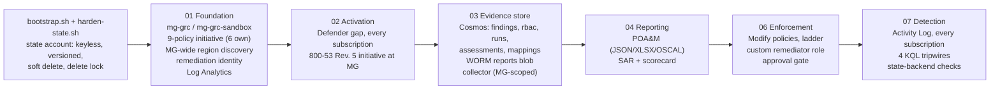

# FAFO Inc. GRC Pipeline (CGE-AZ capstone, federal track)

An automated **governance, risk and compliance (GRC) engineering pipeline on Microsoft Azure**. It governs every subscription under one management group as code, collects compliance evidence on a schedule, writes audit reports (including **OSCAL** SSP and POA&M) from that stored evidence alone, and fixes misconfigurations through one auditable identity, only after a human approves the fix.

**Framework track: Federal, NIST SP 800-53 Rev. 5 Moderate** (tailored), with the System Security Plan and POA&M published as OSCAL 1.1.2.

Built on the [CGE-AZ starter](https://github.com/GRCEngClub/cgeaz) from the GRC Engineering Club and substantially extended. [What this capstone adds](#part-7--what-this-capstone-adds-to-the-starter) is summarized below, and every decision is argued in [docs/DECISIONS.md](docs/DECISIONS.md). FAFO Inc. is the course's fictional scenario; no real company data is used anywhere in this repository.

---

## How to read this README

This README is written for three readers. Jump to the part that fits you.

| You are... | Read | Time |
|---|---|---|
| **A business stakeholder** (the CTO, a deal owner, a customer's security reviewer, the prime contractor) | [Part 1: The plain-language overview](#part-1--the-plain-language-overview) | 10 min |
| **Learning GRC engineering** | [Part 2: Concepts primer](#part-2--grc-engineering-concepts-a-primer), then Part 3, then the [learning path](#part-9--a-learning-path-through-this-repo) | 1-2 h |
| **An engineer or assessor** | [Part 3: Architecture](#part-3--technical-architecture), [Part 4: Deploy](#part-4--deploy-from-an-empty-subscription), [Part 6: Evidence](#part-6--where-an-assessor-should-look) | 30 min |

Contents

1. [The plain-language overview](#part-1--the-plain-language-overview)
2. [GRC engineering concepts: a primer](#part-2--grc-engineering-concepts-a-primer)
3. [Technical architecture](#part-3--technical-architecture)
4. [Deploy from an empty subscription](#part-4--deploy-from-an-empty-subscription)
5. [Verify it yourself](#part-5--verify-it-yourself)
6. [Where an assessor should look](#part-6--where-an-assessor-should-look)
7. [What this capstone adds to the starter](#part-7--what-this-capstone-adds-to-the-starter)
8. [Honest limits and accepted risks](#part-8--honest-limits-and-accepted-risks)
9. [A learning path through this repo](#part-9--a-learning-path-through-this-repo)
10. [Repository layout](#repository-layout)

---

## Part 1 — The plain-language overview

### The situation

**FAFO Inc.** is a 90-person, Series B health-analytics SaaS company that runs entirely on Azure. It has three subscriptions and roughly 400 resources, built by four platform engineers over two years with no governance: no policy assignments, and no evidence anywhere except screenshots in a shared drive.

Three deals are now stacked up behind compliance:

- a **hospital network** that wants HIPAA evidence,
- a **federal pilot** through a prime contractor that wants **NIST SP 800-53** artifacts,
- **two enterprise buyers** asking for **SOC 2**.

The CTO gave FAFO's first GRC engineer 30 days and a sandbox subscription. This repository is what was built.

### The first decision: which market first?

Building for all three at once would mean three half-finished answers. FAFO serves the **federal pilot first**, using NIST SP 800-53 Rev. 5 at the Moderate baseline. The reasons, in plain terms:

1. **It's the strictest of the three.** HIPAA's security safeguards and SOC 2's criteria are routinely mapped *from* 800-53. Meeting the strictest buyer first turns the other two into paperwork, not rebuilds.
2. **The outputs already speak its language.** The pipeline's reports, a POA&M (the official list of open problems with deadlines) and a SAR (the assessment report), are federal documents. The plan itself goes out in **OSCAL**, the machine-readable format federal reviewers increasingly expect.
3. **It holds up to a reviewer who checks the math.** Every control this pipeline claims is checked automatically against NIST's own published catalog, so nothing can cite a control that doesn't exist.

The full argument is [ADR-013](docs/DECISIONS.md#adr-013-framework-track-federal-nist-sp-800-53-rev-5-moderate).

### Why the old way fails

The traditional way to satisfy an auditor is a yearly scramble: screenshots, spreadsheets, a folder handed over. That approach has three problems:

1. **It's a snapshot.** A setting that was correct on audit day can be wrong the next morning, and nobody notices for a year.
2. **It's unverifiable.** A screenshot can't prove when it was taken, that it wasn't edited, or that it shows the whole picture.
3. **It doesn't fix anything.** It only records problems.

### What this pipeline does instead

Think of it as five jobs, each done by software instead of by a person with a spreadsheet:

| Job | In plain words | Analogy |
|---|---|---|
| **1. Set the rules** | Security rules ("no storage may be publicly readable", "data stays in US regions", "nobody holds standing Owner on a subscription") are written as code and attached to the top of FAFO's cloud hierarchy. Every subscription underneath inherits them automatically, including the ones that arrive tomorrow. | Building codes that apply to every new building, not just the ones that exist today. |
| **2. Watch continuously** | Every 6 hours, a collector checks every subscription: which resources follow the rules, which don't, and who has access to what. | A security guard doing rounds four times a day and writing down what they see. |
| **3. Keep tamper-evident records** | Every observation is stored with when it was made and by which run. Each run is sealed with a cryptographic fingerprint, so any later edit is detectable. Reports go into storage that physically can't be altered or deleted for 90 days. | An evidence locker with a sealed log book. |
| **4. Report from the records** | Every day, the pipeline writes a **POA&M** (the to-do list of open problems, with due dates) and a **SAR** (what passes, what fails, what changed, who holds privileged access). Reports read only the stored records, so every number can be traced back and re-checked. | An auditor's report that cites its evidence, page by page. |
| **5. Fix, with permission** | When a known problem needs fixing, the fix is prepared automatically but only runs after a person approves it in a reviewed change. One named robot identity performs every fix, so every automated change has a single, traceable author. | A maintenance crew that has a work order signed by a manager before it touches anything. |

Around those five jobs, the pipeline **protects itself**:

- Any proposed change to the environment is checked against the rules **before** it can be merged (a "compliance gate").
- Every night, it checks whether the real environment still matches the code ("drift detection").
- Every 15 minutes, it checks the audit logs for four specific warning signs: changes by unexpected people, changes outside business hours, secret reads by anything other than the pipeline, and the fixing robot stepping outside its job ("tripwires").

### It works the same for 3 subscriptions as for 1

The sandbox has one subscription and a dozen resources; FAFO has three subscriptions and 400. That's deliberate: the pipeline is built to **scale by scope, not by size**. Nothing in the code names a subscription. When FAFO's other two subscriptions are moved under the governed management group:
- the rules apply to them immediately,
- the next collection includes them,
- and the nightly check flags anything still to be switched on.

No code changes.

### What leadership actually gets

| Output | What it answers | Who uses it |
|---|---|---|
| **POA&M**, daily (spreadsheet, JSON and **OSCAL**) | "What is broken right now, how bad is it, since when, and when must it be fixed?" Due dates follow FedRAMP timelines: High = 30 days, Moderate = 90, Low = 180, counted from the day the problem was **first** seen. | Engineering managers, risk owners, the prime contractor |
| **SAR** + control scorecard, daily | "How does FAFO score against each 800-53 control family? What got fixed since last time? Who holds privileged access?" | Leadership, auditors, customer security reviews |
| **SSP** in OSCAL ([oscal/ssp.json](oscal/ssp.json)) | "How does FAFO implement each control, and with what?" | The federal pilot's reviewers |
| **Alerts** | "Something happened that shouldn't have." | Security / GRC team |
| **Drift issues** on GitHub | "The environment no longer matches what we approved." | Platform engineers |

### What you can rely on, and what you can't

Good GRC work is explicit about the limits of its claims. Here are this pipeline's.

**You can rely on:**
- Rules are enforced the same way everywhere they apply, because they're code inherited from the top of the hierarchy.
- A report's numbers can be re-derived from stored records at any later time ([scripts/reproduce_report.py](scripts/reproduce_report.py)).
- A report will **refuse to publish** if its evidence is stale (older than 13 hours), incomplete (a run where any subscription or source failed), or altered after it was sealed.
- No automated fix runs without a human approval, with a change ticket, recorded in git history.
- No stored passwords or keys are needed for the pipeline's own data, with one documented, time-boxed exception (see [Part 8](#part-8--honest-limits-and-accepted-risks)).

**You should not assume:**
- That "no finding" means "fixed." The SAR only counts something as fixed when it sees an explicit fail-then-pass. A finding that just disappears is reported as "no longer observed."
- That this is production-grade. It's a capstone in a single sandbox subscription. The trade-offs, and what production would do instead, are written down in [docs/DECISIONS.md](docs/DECISIONS.md).
- That HIPAA or SOC 2 are covered *today*. They're the next tracks, and they'll be mapped from the 800-53 controls this pipeline already evidences.

---

## Part 2 — GRC engineering concepts: a primer

If you're learning, read this part slowly. Every concept here shows up in the code, and each entry points to where.

### Controls: preventive, detective, corrective

A **control** is anything that reduces risk. GRC sorts controls by *when* they act:

| Type | Acts | Example in this repo | File |
|---|---|---|---|
| **Preventive** | Before the bad thing happens | Azure Policy `Deny` blocks creating a publicly readable storage account | [stages/01-foundation/policies.tf](stages/01-foundation/policies.tf) |
| **Detective** | Notices after it happens | Azure Policy `Audit` flags a standing subscription Owner; the collector records it | [stages/01-foundation/policies.tf](stages/01-foundation/policies.tf), [functions/collect_assessments/](functions/collect_assessments/) |
| **Corrective** | Fixes it | Azure Policy `Modify` flips a bad setting back, through a remediation task | [stages/06-enforcement/main.tf](stages/06-enforcement/main.tf) |
| **Governance** | Decides who may change the rules | CODEOWNERS review, the approval file, the escalation ladder | [.github/CODEOWNERS](.github/CODEOWNERS), [stages/06-enforcement/approvals.auto.tfvars](stages/06-enforcement/approvals.auto.tfvars) |

[docs/CONTROLS.md](docs/CONTROLS.md) labels every component with its type (P / D / C / G).

### Control catalogs, baselines and tailoring

A **control catalog** is the full list of controls a framework defines. NIST SP 800-53 Rev. 5 has 1,196 (182 of them withdrawn). A **baseline** is the subset a system of a given impact level must implement: **Moderate** is 287 controls. **Tailoring** adjusts the baseline for a real system. FAFO adds one control, SA-9(5) (where data is processed and stored), because data residency is a promise the federal pilot and the hospitals both want.

- The catalog is vendored as data: [frameworks/nist-800-53-rev5.json](frameworks/nist-800-53-rev5.json), generated from NIST's official OSCAL content.
- The tailored baseline is an OSCAL profile: [oscal/fafo-moderate-profile.json](oscal/fafo-moderate-profile.json).
- `tests/test_catalog.py` fails CI if any mapping cites a control that doesn't exist, was withdrawn, or sits outside the tailored baseline. A mapping to a control that doesn't exist is the quietest way to lose an assessment.

### Azure Policy effects

Azure Policy is Azure's built-in rules engine. Each rule ("policy definition") has an **effect**, which decides what happens when a resource breaks the rule:

- **Audit**: allow it, but mark it non-compliant. The safe way to introduce a new rule, because you first *measure* how much it would break.
- **Deny**: refuse the create or update request. Strong, but it can break deployments, so it must be **earned**.
- **Modify**: rewrite a property on the resource (for example, set `minimumTlsVersion` to `TLS1_2`). Needs an identity with permission to make the change.
- **DeployIfNotExists (DINE)**: deploy something that's missing (for example, a diagnostic setting that sends logs to the workspace). Also needs an identity.

In this repo, **every effect is a parameter**, never a literal in the rule. Promoting a control from Audit to Deny is a reviewed variable change, and the rule an assessor reviewed stays the rule that runs.

**Lesson:** Modify and DINE need an identity. If you forget it, the assignment applies cleanly and then silently never fixes anything. Gate rule TF-POL-001 makes that mistake unmergeable ([policy/policy_identity.rego](policy/policy_identity.rego)).

### Management groups, inheritance and "scale by scope"

Azure organizes subscriptions under **management groups** (`mg-grc` → `mg-grc-sandbox` → subscriptions). Anything assigned at a management group applies to every subscription beneath it, **including ones added later**. That's what makes "scale by scope, not by size" possible. The four rules this repo follows:

1. No hardcoded subscription IDs.
2. Assignments at management-group scope.
3. Discovery driven by data sources and `for_each`, not typed lists.
4. Partition keys that include the subscription.

[docs/ARCHITECTURE.md](docs/ARCHITECTURE.md#scale-by-scope-the-four-things-that-make-one-subscription-a-truthful-answer) walks through what happens when FAFO's second subscription arrives.

### Infrastructure as code, state, and stages

**Terraform** describes the environment in files (`*.tf`). `terraform plan` shows what would change, and `terraform apply` makes it so. Terraform remembers what it manages in a **state file**.

- Whoever can write the state can make Terraform believe something false. So the state is treated as a controlled record: no shared keys, versioning, soft delete, and a delete lock ([labs/03-foundation/harden-state.sh](labs/03-foundation/harden-state.sh)), re-checked on every nightly plan ([stages/07-detection/state_backend.tf](stages/07-detection/state_backend.tf)).
- The environment is split into **stages**, each a separate Terraform "root module" with its **own state file**, so a mistake in one stage can't rewrite another's. Stages share information only through outputs (`terraform_remote_state`). That separation is a **blast-radius boundary**.
- A **clean plan** ("No changes") on every stage is the strongest single proof that the repo describes the estate that's actually deployed. That's why the submission bundle exports one per stage.

### Discovery first, then activation

Never switch on a control blindly. **First read** what exists, **measure the gap**, then act only on the gap:

- Stage 02 reads which Microsoft Defender plans are already on in *every* subscription and enables only the missing ones ([stages/02-activation/main.tf](stages/02-activation/main.tf)).
- Stage 01 queries Azure Resource Graph for every resource outside the approved regions across the whole management group. The data-residency policy stays at **Audit** while that count is above zero, and becomes **Deny** automatically once it's zero ([stages/01-foundation/discovery.tf](stages/01-foundation/discovery.tf)). Denying while stragglers exist would block their next update, and the guardrail would cause the outage it exists to prevent.

### Evidence, lineage and integrity

**Evidence** is a record that a control was tested and what the result was. To be worth anything to an auditor, it needs:

- **Lineage:** which run produced it, when it was observed (`collectedAt`), and when the platform last evaluated it (`sourceEvaluatedAt`). Those two times are not the same thing.
- **History:** a new record per run, not an overwrite, so you can say *when* a problem first appeared.
- **Integrity:** a way to detect later changes. Each run's manifest stores a **seal** per container: a SHA-256 digest over the document IDs (catches records added or removed) and one over every document's content (catches a record edited in place).
- **Immutability:** **WORM** (write once, read many) storage. For 90 days, nobody can delete or overwrite a report, including administrators. It's a platform guarantee, not a permission setting.

### Choosing a partition key (and defending it)

Cosmos DB spreads data across **partitions** by a key you choose once and can't change. The key decides which queries are cheap and how large one partition can grow (20 GB). FAFO's findings and role-assignment snapshots use a **hierarchical** key, `[/subscriptionId, /runId]`:
- subscription first, so a new subscription is a new partition and nothing needs reshaping;
- run second, so a subscription's ever-growing history never piles into one partition.

The comparison of all four candidates is in [docs/ARCHITECTURE.md](docs/ARCHITECTURE.md#why-subscriptionid-runid-the-partition-key-chosen-on-purpose). A schema you can't justify is just a schema you copied.

### POA&M, SAR, SSP and OSCAL

- **POA&M (Plan of Action and Milestones):** the standard federal list of open weaknesses, each with a severity, a first-seen date and a scheduled completion date.
- **SAR (Security Assessment Report):** the assessor's view: which controls pass or fail, and what changed since the previous assessment.
- **SSP (System Security Plan):** how the system implements each control, and with which components.
- **OSCAL (Open Security Controls Assessment Language):** NIST's machine-readable JSON/XML format for catalogs, profiles, SSPs and POA&Ms. Here, the SSP is *generated* from a small reviewed file ([scripts/generate_ssp.py](scripts/generate_ssp.py)), and the reporter writes an OSCAL POA&M every day. Both are validated against NIST's official schemas in CI.

### The crosswalk: collect once, map many

A **crosswalk** maps one technical check to the control requirements it evidences. For example, "storage public access disallowed" maps to 800-53 AC-3, SC-7 and CA-7. This repo keeps the crosswalk as **data** ([frameworks/mappings.json](frameworks/mappings.json): 16 controls), versioned by content hash. Each run records which version it used. When FAFO adds the HIPAA or SOC 2 track later, that's new mappings, not new collection.

### Least privilege and segregation of duties (SoD)

- **Least privilege:** each identity gets exactly the permissions its job needs. The remediation identity can update storage account properties but can't read keys, delete accounts, or read data.
- **Segregation of duties:** no single identity does two jobs that should check each other. The **collector** writes evidence but can't write reports. The **reporter** reads evidence and writes reports but can't change evidence, and has **no Azure Resource Manager role at all**, so it physically can't query live systems.
- **Managed identities:** Azure-issued identities for workloads. There's no password to store or leak.

### OIDC federation for CI

GitHub Actions needs to read Azure to run `terraform plan`. Instead of storing a secret, the workflow presents a short-lived **OIDC token** that Azure trusts only if its "subject" matches exactly (`repo:ThePrivacyPrince/CGE-Azure-Capstone:pull_request`). The CI identity is **read-only**: a workflow file can be edited by the very pull request it gates, so the identity's permissions, not the workflow's intent, are the real security boundary.

### Policy as code (the gate)

**OPA / Rego** is a language for writing rules about structured data. **conftest** runs those rules against a Terraform plan exported as JSON. This repo's gate has **12 rules** (11 deny + 1 visibility warning) in [policy/](policy/), with **23 unit tests**. Exceptions are per resource, ticketed, reviewed, and **expire** ([policy/exceptions.rego](policy/exceptions.rego)).

### Drift: the two questions

1. **Does reality match the code?** A nightly `terraform plan -detailed-exitcode` on every stage (exit 2 = differences), which opens a GitHub issue. If the plan itself errors, the job fails rather than reporting "no drift" ([.github/workflows/drift.yml](.github/workflows/drift.yml)).
2. **Who is touching reality?** Activity Log **tripwires**: KQL alert rules over every subscription's audit trail ([kql/](kql/), [stages/07-detection/main.tf](stages/07-detection/main.tf)).

### KQL: asking your logs FAFO's questions

**KQL** (Kusto Query Language) queries the Log Analytics workspace. Each query in [kql/](kql/) answers one question FAFO's customers would ask, and is both readable documentation and the source of a scheduled alert rule. See [kql/README.md](kql/README.md).

### The escalation ladder and blast radius

Enforcement is turned up in reviewed steps: `audit` → `dry-run` → `enforce`, wired to one variable (`remediation_mode`). Before any step, you read the **blast radius**: what it changes, what could break, how you'd know, and how to roll back ([docs/BLAST-RADIUS.md](docs/BLAST-RADIUS.md)). Every policy carries a blast-radius block in its code too. The rule of thumb: **automation acts, humans authorize.**

### The submission is evidence

The grader (like a real auditor or prime contractor) can't log into FAFO's subscription. So the repository carries a **submission bundle**: plans, identity role assignments, policy assignments, the run's documents, the reports, a refused WORM delete, all exported from the live environment and cross-checked against the code ([docs/SUBMISSION.md](docs/SUBMISSION.md)).

---

## Part 3 — Technical architecture

### The stage flow



Deploy order is the numeric order. Stage 05 (an optional AI-narrative stage in the course) isn't built here. Each stage has its own state file in one Entra-only, versioned state account. The end-to-end sequence diagram and the identity diagram are in [docs/ARCHITECTURE.md](docs/ARCHITECTURE.md).

### FAFO's four own artifacts

The brief requires four things the course didn't build. Here they are:

| Artifact | What FAFO built | Where |
|---|---|---|
| **Framework track** | Federal: NIST SP 800-53 Rev. 5 Moderate, tailored (+SA-9(5)); catalog vendored from NIST OSCAL; every mapping machine-checked; SSP + POA&M in OSCAL | [frameworks/](frameworks/), [oscal/](oscal/), [ADR-013](docs/DECISIONS.md#adr-013-framework-track-federal-nist-sp-800-53-rev-5-moderate) |
| **Evidence store schema** | A **role-assignment collector** (something Defender doesn't provide) with its own **`rbac` container**; findings and RBAC on hierarchical keys `[/subscriptionId, /runId]`, justified | [evidence_core.py](functions/collect_assessments/evidence_core.py), [stage 03](stages/03-evidence-store/main.tf), [ARCHITECTURE](docs/ARCHITECTURE.md#evidence-data-model) |
| **KQL** | `off-hours-admin-changes`, `keyvault-secret-reads-non-pipeline` (plus `remediator-out-of-lane`), each a scheduled alert rule | [kql/](kql/) |
| **Policies** | Six own custom definitions beyond the taught three, plus one own corrective control. Each has correct aliases, a parameterized effect, an 800-53 mapping and a blast-radius block | [policies.tf](stages/01-foundation/policies.tf), [06-enforcement](stages/06-enforcement/main.tf) |

### Stage by stage

Each stage below gives what it builds, the files to read, and the GRC lesson it carries.

#### 0. Bootstrap: the state account
- **Builds:** the storage account that holds every stage's Terraform state, with shared keys off, versioning, 30-day soft delete, change feed, and a `CanNotDelete` lock.
- **Read:** [labs/03-foundation/bootstrap.sh](labs/03-foundation/bootstrap.sh), [labs/03-foundation/harden-state.sh](labs/03-foundation/harden-state.sh)
- **Lesson:** the state can't manage itself, so it's created by script and then **re-verified** by Terraform postconditions in stage 07 on every plan.

#### 01. Foundation: hierarchy, rules, the fixer's identity
- **Builds:**
  - Management groups `mg-grc` → `mg-grc-sandbox`. The sandbox subscription joins through an association resource, so Terraform never evicts a subscription someone else moved in.
  - Resource groups, and the Log Analytics workspace `law-grc-sandbox`.
  - The user-assigned **remediation identity** `id-grc-remediation-dev`.
  - A nine-policy **initiative** assigned once at `mg-grc-sandbox`:

| # | Policy | Effect (default) | Why that effect | 800-53 | Source |
|---|---|---|---|---|---|
| 1 | `cge-require-env-tag-rg`: resource groups carry an `env` tag | Audit | Hygiene, not a hard block | CM-8 | Taught |
| 2 | `cge-deny-public-blob`: no public blob access | **Deny** | Clear-cut and framework-mandated: earned | AC-3, AC-6, SC-7 | Taught |
| 3 | `cge-dine-storage-diagnostics`: storage diagnostics to the workspace | DeployIfNotExists | Logging that enforces its own coverage | AU-2, AU-12, SI-4 | Taught |
| 4 | **`fafo-storage-min-tls12`**: storage requires TLS 1.2 | Audit | New control: measure first | SC-8, SC-8(1), SC-13 | **FAFO** |
| 5 | **`fafo-cosmos-no-local-auth`**: Cosmos DB rejects key auth | Audit | Data-service Deny gets its own reviewed change | IA-2, IA-5, AC-2 | **FAFO** |
| 6 | **`fafo-allowed-locations`**: US regions only | Audit until the measured gap is 0, then Deny | Discovery-first | SA-9(5), CM-2 | **FAFO** |
| 7 | **`fafo-keyvault-purge-protection`**: vaults have purge protection | Audit | Seeded vaults lack it; enabling is one-way | SC-12, CP-9 | **FAFO** |
| 8 | **`fafo-audit-subscription-owner`**: no standing subscription Owner | Audit | A finding, not a blocked deploy, until just-in-time access exists | AC-6(5), AC-6(7) | **FAFO** |
| 9 | **`fafo-dine-keyvault-audit-logs`**: vault audit events to the workspace | DeployIfNotExists | The secret-read tripwire has no data without it | AU-2, AU-6, AU-12 | **FAFO** |

- **Read:** [main.tf](stages/01-foundation/main.tf), [policies.tf](stages/01-foundation/policies.tf), [identity.tf](stages/01-foundation/identity.tf), [discovery.tf](stages/01-foundation/discovery.tf)
- **Lesson:** each effect is a *decision* with a reason, recorded next to the code. The `fafo-audit-subscription-owner` policy turns the Lab 1.2 question "who has Owner?" into a control that runs continuously.

#### 02. Activation: Defender plans in every subscription, discovery first
- **Builds:**
  - Reads each baseline Defender plan's tier in **every subscription under the management group** (`for_each` over subscription × plan, via `azapi`), and enables only the gap.
  - Assigns the built-in **NIST SP 800-53 Rev. 5** regulatory-compliance initiative **at the management group**.
- **Read:** [stages/02-activation/main.tf](stages/02-activation/main.tf)
- **Lesson:** the gap map is an *output*, deliberately not a resource key. Keying resources on live values you're about to change makes Terraform undo its own work on the next run (the read-your-own-writes trap).

#### 03. Evidence store: the records FAFO owns
- **Builds:**
  - **Cosmos DB** (serverless, `eastus2`), with key auth disabled. Containers:
    - `findings` `[/subscriptionId, /runId]`: Defender assessments and Policy states, one document per finding per run.
    - **`rbac`** `[/subscriptionId, /runId]`: role-assignment snapshots.
    - `runs` `/runId`: manifests with scope, per-subscription results and a seal per container.
    - `assessments`: the latest-state view.
    - `mappings`: the versioned crosswalk.
  - **Evidence storage account:** shared keys off, OAuth by default, TLS 1.2, versioning, change feed, soft delete, and the `reports` container with a **90-day WORM immutability policy**.
  - `CanNotDelete` locks, and data-plane diagnostic logs.
  - The **collector** Function App (timer every 6 hours). Its identity holds Security Reader and a custom `fafo-grc-policy-state-reader` **at the management group**, plus Cosmos data contributor.
- **How a collection run works** ([evidence_core.py](functions/collect_assessments/evidence_core.py)):
  1. Write the manifest as `started`.
  2. **Discover subscriptions** from the identity's management-group reach.
  3. For each subscription, collect Defender assessments, Policy states and role assignments, each isolated so one throttled API doesn't lose the rest.
  4. Seal each container (ID digest and content digest).
  5. Mark the run `completed`, or `partial` if *any* subscription or source failed. Reports never use a partial run.
- **Lesson:** missing evidence must never read as "no findings."

#### 04. Reporting: numbers that trace to stored records
- **Builds:** the **reporter** Function App with two daily timers: POA&M at 06:40 UTC and SAR at 06:50 UTC. Its identity holds Cosmos **Data Reader** plus a custom `fafo-grc-report-writer` role on the `reports` container only. It has no ARM role.
- **How a report is made** ([reports_core.py](functions/reports/reports_core.py)):
  1. Pick the newest `completed` run. Refuse if it finished more than 13 hours ago.
  2. Load its findings (and, for the SAR, its RBAC snapshots). Recompute both seals, and refuse to publish if anything differs.
  3. Load the exact crosswalk version the run recorded.
  4. Compute first-seen dates from history, then due dates from FedRAMP timelines.
  5. Write the artifacts into a new folder `<report>/<yyyy>/<mm>/<dd>/<timestamp>-<executionId>/`. For the POA&M that's `poam.json`, `poam.xlsx` and `poam.oscal.json`. For the SAR it's `sar.md` and `scorecard.json`, with per-control results grouped by 800-53 family and a privileged-access section. Then write `manifest.json` **last**, with every file's SHA-256 and every Cosmos query verbatim.
- **Lesson:** "reports read from the store only" is enforced by identity, not convention, and [scripts/reproduce_report.py](scripts/reproduce_report.py) can re-run every query later.

#### 06. Enforcement: corrective controls behind a human gate
- **Builds:**
  - Two **Modify** policies, `cge-fix-public-blob` (taught) and **`fafo-fix-min-tls`** (FAFO's own). Each takes its effect as a **parameter**.
  - The custom **`fafo-storage-baseline-remediator`** role, with `listKeys`, `regenerateKey` and `delete` excluded.
  - The **approval gate as code**: remediation tasks exist only for control keys listed in [approvals.auto.tfvars](stages/06-enforcement/approvals.auto.tfvars), each with a change ticket. Terraform refuses an approval without one.
- **The ladder** (`remediation_mode`, default `dry-run`):

| Mode | What happens |
|---|---|
| `audit` | Corrective controls `Disabled`; the stage 01 detective twins keep reporting. The remediator role is **removed**. |
| `dry-run` (default) | `Modify` is deployed with enforcement off. Nothing changes until a reviewer approves a key. |
| `enforce` | `Modify` rewrites every new create or update in flight. Existing resources still need an approved task. |

- **Read:** [stages/06-enforcement/main.tf](stages/06-enforcement/main.tf), [docs/BLAST-RADIUS.md](docs/BLAST-RADIUS.md)

#### 07. Detection: who is touching reality
- **Builds:**
  - Activity Log routing for **every subscription under the management group** (Lab 2's setting adopted with an `import`).
  - An email action group.
  - **Four tripwires**, each loaded from a file in [kql/](kql/) and evaluated every 15 minutes:

| Tripwire | FAFO's question | Own? |
|---|---|---|
| `off-hours-admin-changes` | Are people changing the environment outside the 08:00-18:00 Eastern change window? | **FAFO** |
| `keyvault-secret-reads-non-pipeline` | Who, other than the pipeline, is reading the secrets that guard customer data? | **FAFO** |
| `remediator-out-of-lane` | Did the one identity allowed to fix things do anything else? | **FAFO** |
| `unexpected-writer` | Who is touching reality outside the approved path? | Course-derived |

- **Lesson:** Activity Log rows often arrive late. The rules look back one hour but count only rows *ingested* in the last 15 minutes, so each row is evaluated exactly once.

### Identities and what each can't do

| Identity | Can | Cannot |
|---|---|---|
| Remediation `id-grc-remediation-dev` | Monitoring Contributor (DINE diagnostics); storage property read/write (only when mode ≠ audit) | Read keys, delete storage, read data, touch other resource types |
| Collector | Read Defender, Policy states and role assignments **at the MG**; write Cosmos | Change any resource; write reports |
| Reporter | Read Cosmos; create report blobs | **Any** ARM call; write evidence; delete reports |
| CI planner (GitHub OIDC) | `*/read` + refresh list actions at `mg-grc`; read state | Change anything; write or lock state |
| Human operator | Apply Terraform; approve PRs | n/a (listed as an expected caller for the tripwire) |

### The CI gate ([.github/workflows/gate.yml](.github/workflows/gate.yml))

| Job | Runs on | Credentials | Checks |
|---|---|---|---|
| `static checks (no credentials)` | Every PR, forks included | **None** | `terraform fmt` and `validate` per stage, tflint, checkov, OPA unit tests, the gate must **block** the known-bad fixture and pass the good one, pytest (collector, reports, catalog, OSCAL schemas, KQL, submission verifier), gitleaks |
| `plan + OPA gate (<stage>)` | PRs from this repo only | Read-only OIDC planner | Real `terraform plan -lock=false` per stage → conftest against the plan JSON |

The 12 gate rules are listed in [docs/CONTROLS.md](docs/CONTROLS.md#repo-gates-and-pipeline-operations).

### Scheduled operations

| What | When (UTC) | Where |
|---|---|---|
| Collector, every subscription | every 6 h at :00 | Function timer (`COLLECT_SCHEDULE`) |
| POA&M (JSON, XLSX, OSCAL) | 06:40 daily | Function timer (`POAM_SCHEDULE`) |
| SAR + scorecard | 06:50 daily | Function timer (`SAR_SCHEDULE`) |
| Guide parse canary | 07:00 daily | [guide-ci.yml](.github/workflows/guide-ci.yml) |
| Drift plan, all stages | 08:00 daily | [drift.yml](.github/workflows/drift.yml) |
| Tripwires (4) | every 15 min | Stage 07 alert rules |

---

## Part 4 — Deploy from an empty subscription

Full detail, expected plan outputs and failure modes are in [docs/RUNBOOK.md](docs/RUNBOOK.md). Windows users: [docs/SETUP-WINDOWS.md](docs/SETUP-WINDOWS.md).

**Prerequisites**
- Azure CLI ≥ 2.60 (`az login`), Terraform ≥ 1.9, Python 3.11.
- An Azure subscription where you are **Owner** and can create management groups.
- The one-time setup in [docs/SETUP.md](docs/SETUP.md): resource providers registered, quota probed, budget created.
- **The seeded estate:** run the course's `seed_estate.sh` (CGE-AZ starter) first. It deploys about a dozen cheap resources, several of them deliberately misconfigured, so discovery finds a gap and the reports carry real findings.

**Order**

```bash
export ARM_SUBSCRIPTION_ID=$(az account show --query id -o tsv)
export TF_VAR_subscription_id=$ARM_SUBSCRIPTION_ID     # stage 07 only: where state lives
export TF_VAR_owner_email="<you@example.com>"          # PII: environment only, never committed
export TF_VAR_alert_email="<alerts@example.com>"
export TF_VAR_approved_change_callers='["<your UPN>"]'

./labs/03-foundation/bootstrap.sh                      # 0. state account (versioned, keyless) -> backend.hcl
export TF_VAR_state_storage_account=$(grep storage_account_name labs/03-foundation/backend.hcl | cut -d'"' -f2)
./labs/02-toolkit/route-activity-log.sh                # 0. Activity Log -> workspace (adopted by stage 07)

for s in 01-foundation 02-activation 03-evidence-store 04-reporting 06-enforcement 07-detection; do
  (cd stages/$s && terraform init -backend-config=../../labs/03-foundation/backend.hcl \
     && terraform plan -out=tf.plan && terraform apply tf.plan)
done

python3 labs/04-evidence/seed_frameworks.py            # once: catalog records into Cosmos
./scripts/deploy-functions.sh                          # collector + reports code; timers start now
./labs/06-loop/arm-your-fork.sh <github-user> CGE-Azure-Capstone   # read-only CI identity; add the printed repo variables
```

Then protect `main` (RUNBOOK A.10): require a PR, Code Owner review, and the two gate jobs as required status checks.

Notes:
- **Start the timers early.** Run history accumulating over weeks is graded, and it's the one thing that can't be produced quickly.
- Every apply uses a **saved plan you read first** (`plan -out` then `apply <file>`). The reading *is* the approval.
- Stage 06 deploys in **dry-run** by default. Nothing is remediated until a reviewer approves a control key with a ticket.
- Upgrading an existing lab deployment (renamed policies, the retired `snapshots` container, per-subscription Activity Log) has its own exact steps: [RUNBOOK section A](docs/RUNBOOK.md#a-upgrade-an-existing-lab-deployment-in-place).
- Teardown is deliberately two-step (locks first): [RUNBOOK → Teardown](docs/RUNBOOK.md#teardown).

---

## Part 5 — Verify it yourself

No cloud is needed for these:

```bash
./self-check.sh                                            # the rubric's mechanical checks, all in one
opa test policy/ -v                                        # 23 gate-rule unit tests
conftest test tests/gate-fixtures/bad-plan.json -p policy  # must FAIL (6 failures): the gate blocks a bad plan
conftest test tests/gate-fixtures/good-plan.json -p policy # must pass
pip install pytest openpyxl jsonschema && pytest -q tests  # 97 tests: collector, reports, catalog, OSCAL, KQL, verifier
python3 scripts/generate_ssp.py --check                    # the OSCAL SSP is current with its source
```

`self-check.sh` also checks the four scale-by-scope rules, that every policy in code is in CONTROLS.md, the blast-radius coverage, the own-artifact counts and, once it exists, the submission bundle.

Against the live environment:

```bash
python3 scripts/export_submission.py        # build submission/ (docs/SUBMISSION.md)
python3 scripts/verify_submission.py        # cross-check it against the code, as the grader does
COSMOS_ENDPOINT=$(terraform -chdir=stages/03-evidence-store output -raw cosmos_endpoint) \
  python3 scripts/reproduce_report.py <report folder>/manifest.json   # re-derive any past report
```

---

## Part 6 — Where an assessor should look

| You want to verify | Look at |
|---|---|
| Which 800-53 controls each component implements | [docs/CONTROLS.md](docs/CONTROLS.md), [oscal/ssp.json](oscal/ssp.json) |
| That every mapped control is real and in baseline | [frameworks/nist-800-53-rev5.json](frameworks/nist-800-53-rev5.json), [oscal/fafo-moderate-profile.json](oscal/fafo-moderate-profile.json), `tests/test_catalog.py` |
| Stage flow, identity boundaries, the partition-key decision | [docs/ARCHITECTURE.md](docs/ARCHITECTURE.md) |
| What each enforcement change would break, and the rollback | [docs/BLAST-RADIUS.md](docs/BLAST-RADIUS.md) and the blast-radius block on every policy |
| Why federal, why regions, why dry-run, why the identity split | [docs/DECISIONS.md](docs/DECISIONS.md) |
| That the code matches what's deployed | `submission/` ([docs/SUBMISSION.md](docs/SUBMISSION.md)): per-stage plans, identity role assignments, policy assignments |
| That report numbers come from the store | `submission/reports/` + `submission/evidence/`, or [scripts/reproduce_report.py](scripts/reproduce_report.py) |
| WORM failed-delete proof | `submission/worm/`, [docs/evidence/WORM-PROOF.md](docs/evidence/WORM-PROOF.md) |
| Timers firing over time | `submission/run-history/`, [docs/evidence/RUN-HISTORY.md](docs/evidence/RUN-HISTORY.md) |
| The gate blocking a non-compliant plan | [docs/evidence/GATE-BLOCK.md](docs/evidence/GATE-BLOCK.md) |
| Detect → approve → fix → re-collect → report | [docs/evidence/LAB6-LOOP-CLOSURE.md](docs/evidence/LAB6-LOOP-CLOSURE.md) |

**Mapped to the capstone rubric** (four criteria of 25 points; documentation is read across all four):

| Criterion | Where it's demonstrated |
|---|---|
| **IaC quality** | Six staged root modules with separate state under [stages/](stages/); `azurerm ~> 4.0` pinned with lock files; no hardcoded subscription IDs (self-check enforces it); clean plans per stage in `submission/plans/`; no secrets (gitleaks, scrubbed exports) |
| **Control implementation** | Six own policies + one own corrective control, each with a parameterized effect, an 800-53 mapping and a blast-radius block ([policies.tf](stages/01-foundation/policies.tf)); one whitelisted remediation identity; collector and reporter separated; exported role assignments in `submission/identities/` |
| **Evidence integrity** | WORM proven (`submission/worm/`); shared keys off (`submission/storage/`); extended schema justified ([ARCHITECTURE](docs/ARCHITECTURE.md#evidence-data-model)); every report number recounts from `submission/evidence/` (`scripts/verify_submission.py`); every crosswalk ID resolves in Rev. 5 |
| **Pipeline operations** | Gate blocks a bad PR ([GATE-BLOCK.md](docs/evidence/GATE-BLOCK.md)); nightly drift with detailed exit codes; `remediation_mode` wired to a variable; timers with weeks of history (`submission/run-history/`); four KQL tripwires |

---

## Part 7 — What this capstone adds to the starter

| Area | Starter | FAFO capstone |
|---|---|---|
| Framework | NIST CSF 2.0 view | **Federal track**: NIST SP 800-53 Rev. 5 Moderate, tailored; official catalog vendored; every mapping machine-checked; **OSCAL SSP + POA&M**, schema-validated |
| Own controls | 3 taught policies | **+6 own policies** (TLS floor, Cosmos key-auth ban, data residency, Key Vault purge protection, subscription Owner audit, Key Vault audit logs) and **+1 own corrective control**; every effect a parameter, every policy a blast-radius block |
| Scope | One subscription, named | **Scale by scope**: MG-wide discovery (Resource Graph), per-subscription Defender and Activity Log via `for_each`, collector roles at the MG, nothing names a subscription |
| Evidence schema | Defender assessments, latest state only | `findings` with history, **role-assignment collector + `rbac` container**, hierarchical keys `[/subscriptionId, /runId]`, run manifests sealed per container (ids + content) |
| Reports | Picked the newest *document's* run; same-day paths collided | Completed and fresh runs only; refuse **altered** evidence; one execution ID per folder; manifest written last; FedRAMP due dates from first-seen history; 800-53 family scorecard; privileged-access recount |
| KQL | Taught queries run by hand | **Two FAFO questions** (off-hours changes, secret reads by non-pipeline identities) + remediator out-of-lane, as files that are also the alert rules |
| Remediation identity | Storage Account Contributor | **Custom role**: storage property read/write only, keys and delete excluded |
| Human gate | `az policy remediation create` by hand | **Approval as code** with a required change ticket |
| CI identity | Contributor at `mg-grc` + state write | **Read-only planner** + state reader; fork PRs get a credential-free job only |
| Gate | 3 rules | **12 rules**, **23 OPA tests**; expiring exceptions; evidence-plane and WORM protection |
| Submission | Screenshots | **An evidence bundle** exported from the live estate, plus an offline verifier that cross-checks it the way the grader does |

---

## Part 8 — Honest limits and accepted risks

This is a capstone, not a production system. Each trade-off below is written down, with a compensating control and an exit plan, in the [risk register](docs/DECISIONS.md#risk-register-accepted-with-owners-and-exits).

| Risk | Why accepted | Compensating control | Production answer |
|---|---|---|---|
| **RISK-0001** One shared key: the Functions runtime's scratch storage (Y1 requires it) | Changing plans mid-capstone would replace both apps and their identities | Holds no evidence; SAS lifetime bounded; per-address gate exception that **expires 2027-04-30** | Flex Consumption with identity-based host storage |
| **RISK-0002** `storageAccounts/write` is broader than one property | ARM can't scope a write to a property | `remediator-out-of-lane` tripwire; every write attributable | Property-scoped RBAC condition, if Azure adds one |
| **RISK-0003** Platform-managed encryption keys | Key Vault + rotation adds a dependency for no rubric gain | Encryption at rest by default; Entra-only access | Customer-managed keys |
| **RISK-0004** Evidence storage is LRS | Changing replication on the live WORM account is avoided | WORM, versioning, soft delete, delete lock | GRS / RA-GRS |
| **RISK-0005** The read-only CI planner can read the runtime storage key and the (inert) Cosmos keys | azurerm's refresh reads them | No write anywhere; same-repo PRs only; Cosmos key auth disabled and gate-enforced | Flex Consumption removes the storage key |
| Per-subscription settings converge on the next apply, not instantly | Defender tiers and Activity Log settings can't be inherited like policy | Nightly drift flags a new subscription until applied | Policy-driven DINE for Defender and diagnostics |
| WORM policy is **unlocked** | So the course teardown works | Retention still enforced while unlocked | Lock it: then nobody can shorten or remove it |

A note on the evidence seal: the seals prove a run's documents haven't changed since the collector sealed them. The collector's own identity still has write access to Cosmos, so the strongest independent anchor is the report manifest in WORM storage, which records both seals at report time and can't be altered for 90 days.

---

## Part 9 — A learning path through this repo

If you're studying GRC engineering, work through the repo in this order. Each step builds on the last.

1. **Start with the "why."** Read [docs/DECISIONS.md](docs/DECISIONS.md), especially ADR-013 (the track) and ADR-014 (scope). Practice saying each decision in one sentence.
2. **Rules as code.** Read [stages/01-foundation/policies.tf](stages/01-foundation/policies.tf). For each policy, ask: what's the effect, why that effect, and what would break at Deny? Check your answers against its blast-radius block.
3. **Catalogs are data.** Open [frameworks/nist-800-53-rev5.json](frameworks/nist-800-53-rev5.json) and find AC-6(5). Then run `pytest -q tests/test_catalog.py` and read why each check exists. Exercise: map a crosswalk entry to `AC-99` and watch CI refuse it.
4. **Scale by scope.** Read [discovery.tf](stages/01-foundation/discovery.tf), [02-activation](stages/02-activation/main.tf) and `discover_subscriptions` in [evidence_core.py](functions/collect_assessments/evidence_core.py). Then read `test_new_subscription_is_collected_with_no_configuration_change` in [tests/test_collector.py](tests/test_collector.py).
5. **Evidence that holds up.** Read the evidence data model in [docs/ARCHITECTURE.md](docs/ARCHITECTURE.md#evidence-data-model), then `run_collection`. Exercise: in a test, change one finding from `fail` to `pass` and watch the report refuse to publish.
6. **Reports that trace back.** Read [reports_core.py](functions/reports/reports_core.py) and [tests/test_reports.py](tests/test_reports.py), including `test_poam_open_count_equals_failing_findings_in_the_run`. That's exactly the grader's recompute.
7. **OSCAL.** Read [frameworks/ssp-implementation.json](frameworks/ssp-implementation.json), run `python3 scripts/generate_ssp.py`, and compare with [oscal/ssp.json](oscal/ssp.json). Then read [tests/test_oscal.py](tests/test_oscal.py).
8. **The gate.** Read [policy/storage.rego](policy/storage.rego) and [policy/gate_test.rego](policy/gate_test.rego). Exercise: add a rule requiring blob versioning, with a failing and a passing test, and run `opa test policy/ -v`.
9. **Your logs, FAFO's questions.** Read [kql/README.md](kql/README.md) and each query. Exercise: write a third FAFO query, for example "role assignments created outside a PR merge window", and wire it into stage 07.
10. **The submission is evidence.** Read [docs/SUBMISSION.md](docs/SUBMISSION.md), then [scripts/verify_submission.py](scripts/verify_submission.py). For each check, name the deduction it prevents.

**Words worth knowing** (each appears above): control types (P/D/C/G) · catalog · baseline · tailoring · OSCAL (catalog, profile, SSP, POA&M) · Azure Policy effect · initiative · management group · scale by scope · root module · remote state · clean plan · blast radius · discovery-first · drift · tripwire · KQL · managed identity · OIDC federation · least privilege · segregation of duties · evidence lineage · seal / digest · idempotency · hierarchical partition key · WORM · POA&M · SAR · SSP · crosswalk · collect once, map many · policy as code · fail closed · compensating control · risk acceptance · evidence package.

---

## Repository layout

```
stages/       one Terraform root module per stage, each with its own state file
  01-foundation/      hierarchy, initiative (9 policies, 6 own), remediation identity, discovery.tf
  02-activation/      Defender gap per subscription, NIST SP 800-53 Rev. 5 initiative at the MG
  03-evidence-store/  Cosmos (findings, rbac, runs, assessments, mappings, frameworks), WORM blob, collector app
  04-reporting/       reporter app, custom no-delete report-writer role
  06-enforcement/     Modify policies, escalation ladder, custom remediator role, approval gate
  07-detection/       Activity Log routing (every subscription) + 4 KQL tripwires + state-backend checks
functions/    collector (collect_assessments/) and reports/ - Python, timer-triggered, managed identity
frameworks/   mappings.json (crosswalk), nist-800-53-rev5.json (catalog), ssp-implementation.json (SSP source)
oscal/        ssp.json (generated) and fafo-moderate-profile.json (tailored baseline)
kql/          FAFO's queries; each is also a stage 07 alert rule
policy/       OPA/conftest gate rules, unit tests, time-boxed exceptions
tests/        pytest (collector, reports, catalog, OSCAL, KQL, submission verifier); schemas/; gate-fixtures/
scripts/      deploy-functions, generate_ssp, export_submission, verify_submission, reproduce_report, export_run_history
docs/         ARCHITECTURE, CONTROLS, BLAST-RADIUS, DECISIONS, RUNBOOK, SUBMISSION, SETUP, evidence/
labs/         the six CGE-AZ lab guides (course material, lightly modified)
.github/      gate.yml (PR gate), drift.yml (nightly drift), guide-ci.yml, CODEOWNERS
submission/   (after export) the evidence bundle the grader reads
```

*Built on the GRC Engineering Club CGE-AZ starter. FAFO Inc. is the course's fictional scenario; no real company data is used.*
