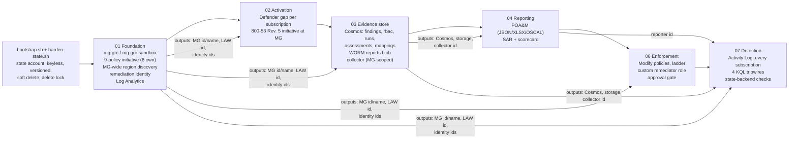
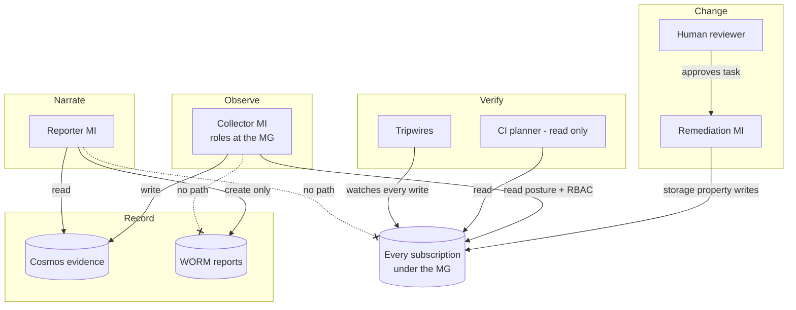

# Architecture

FAFO Inc. has three subscriptions and roughly 400 resources. This build runs in one sandbox subscription with a dozen seeded resources. The architecture is written so that difference doesn't matter: **it scales by scope, not by size.** Every design choice below answers the question "what happens tomorrow, when FAFO's other two subscriptions are moved under the management group?"

## Scale by scope: the four things that make one subscription a truthful answer

| Requirement | How it's met | Where |
|---|---|---|
| **No hardcoded subscription IDs** | Subscriptions come from data sources (`data.azurerm_management_group.*.all_subscription_ids`), Resource Graph, or the collector's own role reach. The only subscription value is `var.subscription_id` in stage 07, documented as the state account's home, and governance never keys off it. `self-check.sh` fails on any GUID in `stages/` that isn't a platform constant. | stages 02, 07; `self-check.sh` |
| **Assignments at management-group scope** | The FAFO baseline initiative, both corrective controls and the built-in NIST SP 800-53 Rev. 5 initiative are all assigned at `mg-grc-sandbox`. A subscription inherits them the moment it lands. Membership is an association resource, so Terraform never evicts a subscription someone moved in by hand. | stages 01, 02, 06 |
| **Discovery from data sources and `for_each`, not typed lists** | Region discovery is a Resource Graph query over the whole MG. Defender plans are `for_each` over (every subscription under the MG × baseline plan). Activity Log routing is `for_each` over every subscription. The collector discovers subscriptions from its MG-scoped roles every run. | `discovery.tf`, stage 02, stage 07, `evidence_core.discover_subscriptions` |
| **Partition keys that include the subscription** | `findings` and `rbac` use hierarchical keys `[/subscriptionId, /runId]`. A new subscription is a new top-level partition, with nothing to reshape (reasoning [below](#evidence-data-model)). | stage 03 |

What happens when FAFO's second subscription arrives:

1. Someone moves it under `mg-grc-sandbox` (an onboarding step, not a code change).
2. **Immediately:** Azure Policy evaluates it against the whole initiative and the 800-53 initiative (inheritance).
3. **Next collector run (≤ 6 h):** its Defender assessments, Policy states and role assignments land in `findings` and `rbac` under its own partition. The run manifest lists it in `scope.subscriptions`.
4. **Next nightly drift run:** stages 02 and 07 plan changes (enable Defender, route its Activity Log). Drift opens an issue, and the next apply closes it. Until then, the gap is visible rather than silent.
5. **Next POA&M/SAR:** its findings appear, with first-seen dates from its own history. The SAR's privileged-access table gains a row.

## Stage flow

Each stage is a separate Terraform root module with its own state file (`<stage>.tfstate` in one keyless, versioned state account). Stages talk to each other only through **outputs** read with `terraform_remote_state`. No stage edits another stage's resources, so a bad apply in one stage can't rewrite another's state.



Deploy order is the numeric order. Stage 05 (AI narrative) is optional in the course and isn't built here.

## The loop, end to end

```mermaid
sequenceDiagram
  autonumber
  participant AP as Azure Policy (MG-inherited)
  participant DF as Defender for Cloud
  participant C as Collector (timer, 6h)
  participant DB as Cosmos (findings, rbac, runs)
  participant R as Reporter (timer, daily)
  participant W as WORM blob (reports)
  participant H as Reviewer (PR)
  participant RI as Remediation identity
  participant AL as Activity Log + tripwires
  C->>DB: run manifest "started"
  C->>C: discover subscriptions its MG roles reach
  loop every subscription
    C->>AP: policy states
    C->>DF: assessments
    C->>C: role assignments + definitions
  end
  C->>DB: findings + rbac docs (key [subscriptionId, runId])
  C->>DB: manifest "completed" + per-subscription results + seal per container
  R->>DB: newest COMPLETED, fresh run; verify findings and rbac seals
  R->>W: poam.json/xlsx/oscal.json, sar.md, scorecard.json, then manifest.json LAST
  H->>H: reads the POA&M, opens a PR adding control key + ticket
  H->>AP: merge + apply creates a remediation task
  AP->>RI: task executes AS the user-assigned identity
  RI->>AL: storageAccounts/write (caller = principal ID)
  AL->>AL: tripwires: out of lane? off hours? unexpected writer? secret read?
  C->>DB: next run records the control passing; SAR delta lists it under "fixed"
```

## Identity boundaries

| Identity | Type | Can | Cannot | Granted in |
|---|---|---|---|---|
| **Remediation** `id-grc-remediation-dev` | User-assigned MI | Monitoring Contributor at `mg-grc-sandbox` (DINE diagnostics); `fafo-storage-baseline-remediator` at `mg-grc-sandbox` (storage read/write, only when mode ≠ audit) | listKeys, regenerate keys, delete storage, read data, touch any other resource type | 01, 06 |
| **Collector** (function app MI) | System-assigned MI | Security Reader **at the MG** (Defender assessments, role assignments); `fafo-grc-policy-state-reader` **at the MG**; Cosmos Built-in Data Contributor | Change any resource; write report blobs | 03 |
| **Reporter** (function app MI) | System-assigned MI | Cosmos Built-in Data Reader; `fafo-grc-report-writer` on the `reports` container (create + read) | **Any ARM call** (no ARM role at all); write evidence; delete or overwrite a report | 04 |
| **CI planner** (GitHub OIDC, app registration) | Federated SP | `fafo-grc-ci-planner` at `mg-grc` (`*/read` + refresh list actions); Blob Data **Reader** on the state container | Change any resource; write or lock state | `arm-your-fork.sh` |
| **Human operator** | Entra user | Apply Terraform (Owner on the sandbox subscription), approve PRs | n/a (listed in `approved_change_callers` so the tripwire expects their writes) | Bootstrap |



Separation of duties is enforced by role **scope**, not by code review. The collector has no data action on the reports container. The reporter has no write on Cosmos and no ARM role. Only the remediation identity has a write role on resources, and only on storage properties. The submission bundle exports every identity's actual role assignments so this can be checked against the deployed estate, not just the code (`scripts/verify_submission.py`).

## Evidence data model

| Container | Partition key | One document per | Written by | Purpose |
|---|---|---|---|---|
| `findings` | **`[/subscriptionId, /runId]`** (hierarchical) | finding, per subscription, per run | collector | History. `id = sha256(runId \| findingKey)`; `findingKey = sha256(source \| nativeId \| resourceId)` is stable across runs |
| `rbac` | **`[/subscriptionId, /runId]`** (hierarchical) | role assignment, per subscription it applies to, per run | collector (role-assignment collector) | Who can act on each subscription: scope level, inheritance, privileged flag, created-on |
| `runs` | `/runId` | run | collector | Manifest: status, trigger, scope (MG + subscriptions), per-subscription results, crosswalk version, a seal per container (`documentSetSha256` ids, `contentSetSha256` contents) |
| `assessments` | `/subscriptionId` | Defender finding (latest) | collector | Starter's latest-state view, same id formula, kept for compatibility |
| `mappings` | `/frameworkId` | crosswalk version | collector | `frameworks/mappings.json`, versioned by content hash |
| `frameworks` | `/frameworkId` | framework element | seed script | Catalog records (Lab 4) |
| `snapshots` | `/runId` | (retired) | none | The first history container. Kept in Azure, forgotten by Terraform (`removed { destroy = false }`), never deleted (TF-EVD-001) |

### Why `[/subscriptionId, /runId]`: the partition key chosen on purpose

A Cosmos DB partition key decides two things: which queries are cheap, and how big one logical partition can grow (20 GB). Four candidates were weighed against FAFO's actual reads and its three-subscription future.

| Candidate | Hot read: "one run, every subscription" (every report) | "One subscription's history" (first-seen, access review) | Growth over time | Second subscription arrives |
|---|---|---|---|---|
| `/runId` (the first design) | single partition | fan-out across **every run ever** | bounded per run | fine, **but nothing in the key knows about subscriptions**: a 400-resource subscription and a 12-resource one share every partition |
| `/subscriptionId` | fan-out, one partition per subscription | single partition | **unbounded**: all of a subscription's history in one logical partition, ~4 runs a day forever, eventually hitting the 20 GB cap | new partition, fine |
| `/id` | full fan-out | full fan-out | bounded | fine, but every query is a scan |
| **`[/subscriptionId, /runId]`** | fan-out to exactly one partition per subscription (3 for FAFO) | prefix query on `subscriptionId`: targeted to that subscription's physical partitions | **bounded per (subscription, run)**: the 20 GB cap applies to the full key path | **new top-level partition the moment its first document lands, nothing reshaped** |

The hierarchical key keeps the good property of each flat option and drops the bad one. Subscription first, because that's the unit FAFO's estate grows by and the unit of accountability (each subscription has an owner). Run second, because history grows by runs, and putting run under subscription bounds every logical partition. Cosmos supports hierarchical keys on serverless accounts (`partition_key_kind = "MultiHash"`, version 2).

`runs` stays on `/runId`: a run spans every subscription, so subscription can't partition it. Manifests are tiny, and they're always read by `runId` or "newest completed".

### Why a role-assignment collector, and why its own container

Defender tells FAFO what is misconfigured. It doesn't tell FAFO **who can change things**, which is the first question the federal pilot (AC-2, AC-6(5), AC-6(7)) and every SOC 2 auditor will ask. The role-assignment collector records, every run and for every subscription, every assignment that applies there (including those inherited from the management group and root), with the role's name and whether it's privileged.

It gets its own container because the documents are a different shape with a different lifecycle. A finding has a pass/fail result and a first-seen date. A role assignment has a principal, a scope and a privilege level, and it's reviewed as a population ("all standing Owners on subscription S at run R"), not as individual weaknesses. Mixing them would make every findings query filter out RBAC documents, and every access review filter out findings. The SAR recounts its privileged-access table from this container, and `fafo-audit-subscription-owner` flags the same population through Azure Policy. Two independent sources for the same claim.

Report blobs: `<report>/<yyyy>/<mm>/<dd>/<timestamp>-<executionId>/{artifacts..., manifest.json}`. A folder without `manifest.json` is an incomplete execution.

## Timing (UTC)

| What | When | Why then |
|---|---|---|
| Collector | every 6 h at :00 | Four snapshots a day; remediation shows up within hours |
| POA&M (JSON, XLSX, OSCAL) | 06:40 daily | After the 06:00 collection has completed |
| SAR + scorecard | 06:50 daily | Offset from the POA&M |
| Guide parse canary (GitHub) | 07:00 daily | Catches provider/CLI drift before a learner does |
| Drift plan, every stage (GitHub) | 08:00 daily | After reports, before the working day |
| Tripwires (4) | every 15 min (new rows by ingestion time, 1 h look-back) | Detection latency for out-of-band change, without missing Activity Log rows that arrive late |

Azure Policy evaluation, Defender assessment refresh, Activity Log ingestion and these schedules aren't atomic. A fix made at 10:00 can show as Policy-compliant before Defender re-assesses it. The SAR lists explicit fail → pass transitions only. A finding that merely disappears is reported as "no longer observed", not as fixed.
