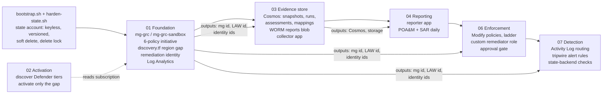
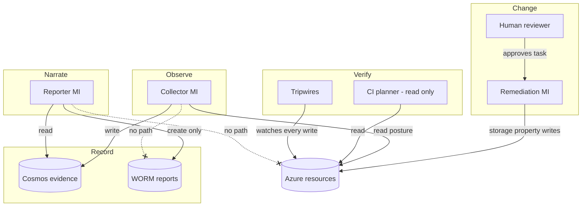

# Architecture

## Stage flow

Each stage is a separate Terraform root module with its own state file (`<stage>.tfstate` in one keyless, versioned state account). Stages talk to each other only through **outputs** read with `terraform_remote_state`; no stage edits another stage's resources. A bad apply in one stage cannot rewrite another stage's state.



Deploy order is the numeric order. Stage 05 (AI narrative) is optional in the course and not built here.

## The loop, end to end

```mermaid
sequenceDiagram
  autonumber
  participant AP as Azure Policy
  participant DF as Defender for Cloud
  participant C as Collector (timer, 6h)
  participant DB as Cosmos (snapshots, runs)
  participant R as Reporter (timer, daily)
  participant W as WORM blob (reports)
  participant H as Reviewer (PR)
  participant RI as Remediation identity
  participant AL as Activity Log + tripwires
  AP->>AP: evaluate storage accounts (async, minutes)
  C->>DB: run manifest "started"
  C->>AP: query policy states (POST, paginated)
  C->>DF: list assessments (paginated)
  C->>DB: one snapshot per finding (id = sha256(runId|findingKey))
  C->>DB: run manifest "completed" + document-set digest
  R->>DB: newest COMPLETED run, its snapshots, crosswalk version, first-seen history
  R->>W: poam.json + poam.xlsx (+ sar.md, scorecard.json), then manifest.json LAST
  H->>H: reads POA&M, opens PR adding control key + ticket to approvals.auto.tfvars
  H->>AP: merge + apply creates remediation task
  AP->>RI: task executes AS the user-assigned identity
  RI->>AL: storageAccounts/write (caller = principal ID)
  AL->>AL: tripwire 2 checks the remediator stayed in its lane
  C->>DB: next run records the control passing; SAR delta lists it under "fixed"
```

## Identity boundaries

| Identity | Type | Can | Cannot | Granted in |
|---|---|---|---|---|
| **Remediation** `id-grc-remediation-dev` | User-assigned MI | Monitoring Contributor at `mg-grc-sandbox` (DINE diagnostics); `tf-storage-baseline-remediator` at `mg-grc-sandbox` (storage read/write, only when mode != audit) | listKeys, regenerate keys, delete storage, read data, touch any other resource type | 01, 06 |
| **Collector** (function app MI) | System-assigned MI | Security Reader (subscription); `tf-grc-policy-state-reader` (subscription); Cosmos Built-in Data Contributor | Change any resource; write report blobs | 03 |
| **Reporter** (function app MI) | System-assigned MI | Cosmos Built-in Data Reader; `tf-grc-report-writer` on the `reports` container (create + read) | **Any ARM call** (no ARM role at all); write evidence; delete or overwrite a report | 04 |
| **CI planner** (GitHub OIDC, app registration) | Federated SP | `tf-grc-ci-planner` at `mg-grc` (`*/read` + refresh list actions); Blob Data **Reader** on the state container | Change any resource; write or lock state | `arm-your-fork.sh` |
| **Human operator** | Entra user | Apply Terraform (Owner on the sandbox subscription), approve PRs | - (listed in `approved_change_callers` so the tripwire expects their writes) | Bootstrap |



The separation of duties is enforced by role **scope**, not by code review: the collector has no data action on the reports container, the reporter has no write on Cosmos and no ARM role, and only the remediation identity has a write role on resources (and only storage, and only properties).

## Evidence data model

| Container | Partition key | One document per | Written by | Purpose |
|---|---|---|---|---|
| `snapshots` | `/runId` | finding per run | collector | History. `id = sha256(runId \| findingKey)`; `findingKey = sha256(source \| nativeId \| resourceId)` is stable across runs |
| `runs` | `/runId` | run | collector | Manifest: status, trigger, counts, per-source errors, crosswalk version, `documentSetSha256` |
| `assessments` | `/subscriptionId` | Defender finding (latest) | collector | Starter's latest-state view, same id formula, kept for compatibility |
| `mappings` | `/frameworkId` | crosswalk version | collector | `frameworks/mappings.json`, versioned by content hash |
| `frameworks` | `/frameworkId` | framework element | seed script | NIST CSF 2.0 catalog (Lab 4) |

Report blobs: `<report>/<yyyy>/<mm>/<dd>/<timestamp>-<executionId>/{artifacts..., manifest.json}`. A folder without `manifest.json` is an incomplete execution.

## Timing (UTC)

| What | When | Why then |
|---|---|---|
| Collector | every 6 h at :00 | Four snapshots a day; remediation shows up within hours |
| POA&M | 06:40 daily | After the 06:00 collection has completed |
| SAR + scorecard | 06:50 daily | Offset from the POA&M |
| Drift plan (GitHub) | 08:00 daily | After reports, before the working day |
| Tripwires | every 15 min | Detection latency for out-of-band change |

Azure Policy evaluation, Defender assessment refresh, Activity Log ingestion and these schedules are **not atomic**. A fix made at 10:00 can show as Policy-compliant before Defender re-assesses it. The SAR lists explicit fail -> pass transitions only; a finding that merely disappears is reported as "no longer observed", not as fixed.
